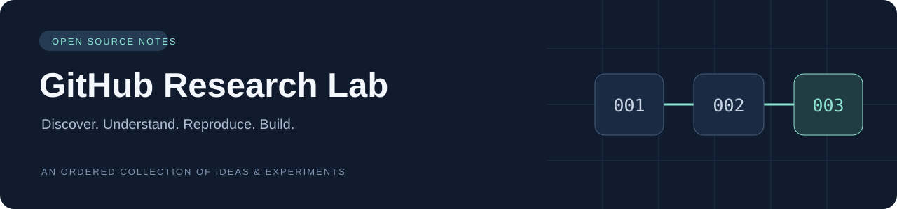
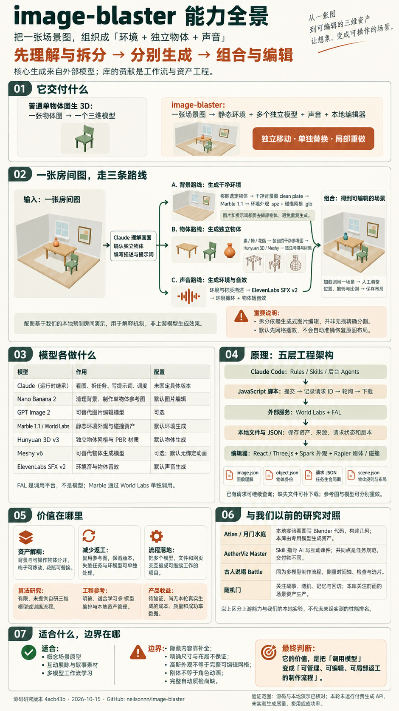
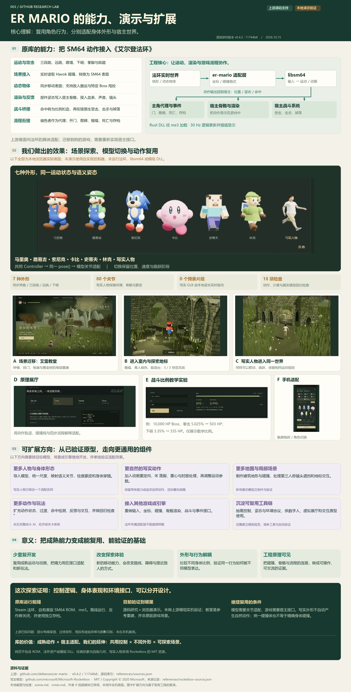
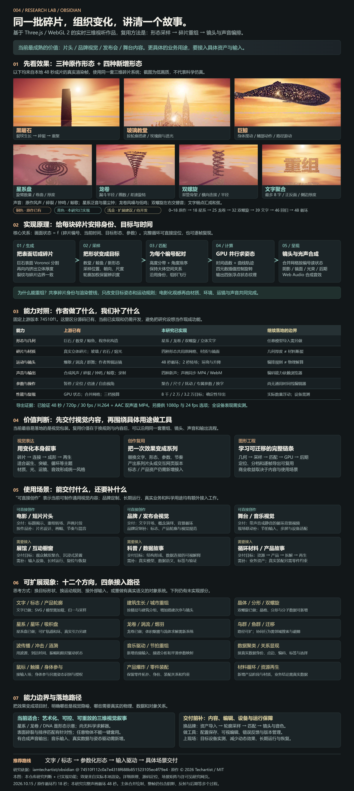
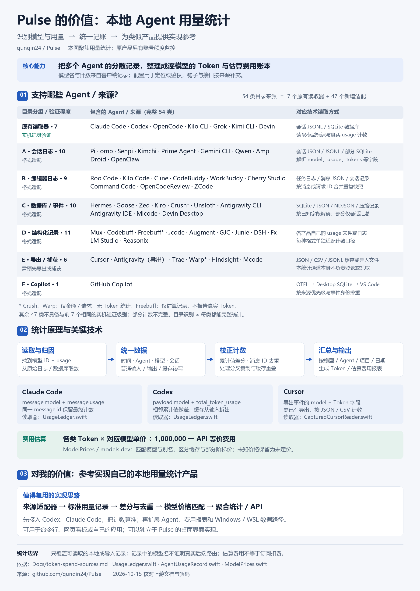
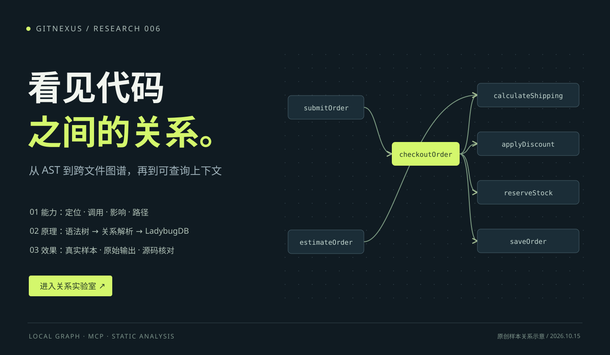
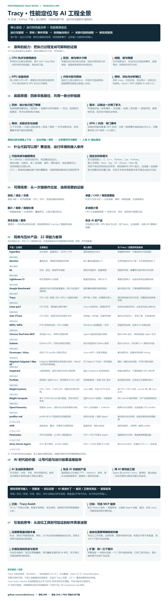
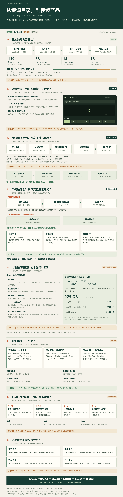
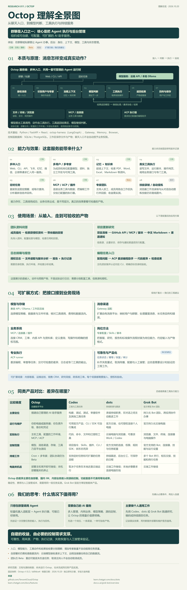
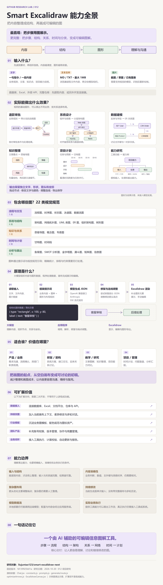

<p align="center">
  
</p>

# GitHub Research Lab

我的 GitHub 优秀项目研究总仓库。把遇到的好项目按顺序收录，记录它解决的问题、值得学习的设计，以及亲手运行和改造后的结论。

**从这里开始：** [项目索引](#项目索引) · [研究与收录规范](docs/project-guide.md) · [新增项目](#新增一个研究项目) · [Web 部署约定](docs/deployment.md)

## 项目索引

编号代表收录顺序，采用 `001`、`002`、`003`……；分配后保持不变。首页按编号升序展示，删除或归档项目时不重排其他编号。

<!-- PROJECTS:START -->

已收录 **11** 个项目，按收录编号升序展示。

| 编号 | 项目 | 源库 | 摘要 | 状态 | 入口 |
| --- | --- | --- | --- | --- | --- |
| 001 | [AetherViz Master 课件生成规范研究](projects/001-aetherviz-master/README.md) | [aetherviz-master](https://github.com/andyhuo520/aetherviz-master) | 通过提示词规范指导 AI 生成生物、物理、化学等互动课件，可按知识顺序组织为系列课程。 | 已完成 | [研究](projects/001-aetherviz-master/README.md) · [演示](https://yydshly.github.io/1015_codex_project/projects/001-aetherviz-master/overview.html) |
| 002 | [image-blaster 图生三维工作流研究](projects/002-image-blaster/README.md) | [image-blaster](https://github.com/neilsonnn/image-blaster) | 将场景图拆成背景、独立物体与声音，借助外部模型生成并组装三维场景；价值在资产解耦、请求恢复和局部返工，可扩展自动布局与质量验收。 | 已完成 | [研究](projects/002-image-blaster/README.md) · [演示](https://yydshly.github.io/1015_codex_project/projects/002-image-blaster/) |
| 003 | [ER Mario 跨游戏动作系统研究](projects/003-er-mario/README.md) | [er-mario](https://github.com/deltarooo/er-mario) | 复用 SM64 运动与动画，经碰撞、骨骼、战斗与事件适配接入法环；用艾雷教堂和七模型演示说明行为与外形解耦、减少重复开发的价值，并梳理更多角色、场景与引擎的扩展条件。 | 已完成 | [研究](projects/003-er-mario/README.md) · [演示](https://yydshly.github.io/1015_codex_project/projects/003-er-mario/overview.html) |
| 004 | [Obsidian 程序化碎片变形研究](projects/004-obsidian/README.md) | [obsidian](https://github.com/iamtechartist/obsidian) | 以表面碎裂、目标采样匹配和 GPU 时间函数驱动同一批三维碎片重组，适合片头、品牌与舞台视觉；研究页扩展四种形态、48 秒声画循环和 MP4 导出，并梳理模型、音乐、数据与交互的扩展条件。 | 已完成 | [研究](projects/004-obsidian/README.md) · [演示](https://yydshly.github.io/1015_codex_project/projects/004-obsidian/#understanding) |
| 005 | [Pulse 本地 Agent 用量统计研究](projects/005-pulse/README.md) | [Pulse](https://github.com/qunqin24/Pulse) | 读取多种 Agent 的本地日志、数据库与导出记录，校正累计值和重复消息，按模型归集 Token 与 API 等价费用；为自建用量统计模块提供采集、归因、计价和扩展参考。 | 已完成 | [研究](projects/005-pulse/README.md) · [演示](https://yydshly.github.io/1015_codex_project/projects/005-pulse/overview.html) |
| 006 | [GitNexus 代码知识索引与 AI 工具接入研究](projects/006-gitnexus/README.md) | [GitNexus](https://github.com/abhigyanpatwari/GitNexus) | 解析源码与跨文件关系，构建 LadybugDB 代码知识索引，经 CLI/MCP 提供检索、调用路径与变更影响；以真实小样本区分效果和缺口，研究可核对上下文的价值，并梳理变更审查、架构导航及 Agent 服务等扩展方向。 | 已完成 | [研究](projects/006-gitnexus/README.md) · [演示](https://yydshly.github.io/1015_codex_project/projects/006-gitnexus/) |
| 007 | [追剧资源接口验证与网页播放 Demo](projects/007-zhuiju-source-demo/README.md) | [awesome-zhuiju-free](https://github.com/laoma528/awesome-zhuiju-free) | 从公开配置发现暴风 HTTP 接口，实测搜索、详情和首两集 1080p 播放；提供本地搜片、8 集选集与 HLS 播放 Demo。 | 已完成 | [研究](projects/007-zhuiju-source-demo/README.md) |
| 009 | [Tracy 运行时性能定位与 AI 优化研究](projects/009-tracy-performance/README.md) | [tracy](https://github.com/wolfpld/tracy) | 以采样、区间埋点和事件定位运行时性能瓶颈；官方接入 C/C++、Python、Lua、Fortran，Rust/C# 等有第三方绑定，并支持 OpenGL/Vulkan/CUDA 等 GPU API。面向 AI/GitHub 项目的游戏、桌面与服务优化，为开发者和编码 Agent 提供可复测证据；可扩展为自动性能回归组件，完整质量检测需结合业务测试、静态与运行时检查。 | 已完成 | [研究](projects/009-tracy-performance/README.md) · [演示](https://yydshly.github.io/1015_codex_project/projects/009-tracy-performance/) |
| 010 | [追剧资源库与视频产品全链路研究](projects/010-zhuiju-product-research/README.md) | [awesome-zhuiju-free](https://github.com/laoma528/awesome-zhuiju-free) | 源库用 JSON 资源目录、维护者审核和定时 HTTP 检测整理影视入口。研究验证配置→API→HLS 的搜播链路，说明同类产品的内容授权、接口适配、存储/CDN与盈利验证；附全景图、实测证据和本地 Demo。 | 已完成 | [研究](projects/010-zhuiju-product-research/README.md) · [演示](https://yydshly.github.io/1015_codex_project/projects/010-zhuiju-product-research/) |
| 011 | [Octop 自建 AI 助手平台研究](projects/011-octop/README.md) | [Octop](https://github.com/TencentCloud/Octop) | 把群聊、网页与定时任务接入自建 Agent 服务，整合模型、记忆、知识库与工具执行，形成资料回答、简报、报告或代码差异。群聊只是入口；价值在多人管理、内网业务与模型/源码控制，可经 MCP、ACP、技能和渠道扩展，并对比 Codex、dots、官方 Grok 的托管与自建取舍。 | 已完成 | [研究](projects/011-octop/README.md) · [演示](https://yydshly.github.io/1015_codex_project/projects/011-octop/) |
| 012 | [Smart Excalidraw 场景与图表能力研究](projects/012-smart-excalidraw-next/README.md) | [smart-excalidraw-next](https://github.com/liujuntao123/smart-excalidraw-next) | AI 将文字、文档与截图中的步骤、结构、关系和时间组织成图形 JSON，经部分修复与箭头端点调整，由 Excalidraw 渲染为可编辑图表。含 22 类规范及流程、架构、ER、思维导图、甘特与能力树示例；可扩展数据接入、行业模板、持续改图和团队协作。 | 已完成 | [研究](projects/012-smart-excalidraw-next/README.md) · [演示](https://yydshly.github.io/1015_codex_project/projects/012-smart-excalidraw-next/) |

### 项目预览

#### 001 · AetherViz Master 课件生成规范研究

[](projects/001-aetherviz-master/README.md)

通过提示词规范指导 AI 生成生物、物理、化学等互动课件，可按知识顺序组织为系列课程。

标签：AI Skill · 教育可视化 · Three.js

#### 002 · image-blaster 图生三维工作流研究

[](projects/002-image-blaster/README.md)

将场景图拆成背景、独立物体与声音，借助外部模型生成并组装三维场景；价值在资产解耦、请求恢复和局部返工，可扩展自动布局与质量验收。

标签：图生3D · AI工作流 · 源码研究

#### 003 · ER Mario 跨游戏动作系统研究

[](projects/003-er-mario/README.md)

复用 SM64 运动与动画，经碰撞、骨骼、战斗与事件适配接入法环；用艾雷教堂和七模型演示说明行为与外形解耦、减少重复开发的价值，并梳理更多角色、场景与引擎的扩展条件。

标签：游戏模组 · 跨引擎整合 · 交互演示

#### 004 · Obsidian 程序化碎片变形研究

[](projects/004-obsidian/README.md)

以表面碎裂、目标采样匹配和 GPU 时间函数驱动同一批三维碎片重组，适合片头、品牌与舞台视觉；研究页扩展四种形态、48 秒声画循环和 MP4 导出，并梳理模型、音乐、数据与交互的扩展条件。

标签：Three.js · 程序化动画 · 交互演示

#### 005 · Pulse 本地 Agent 用量统计研究

[](projects/005-pulse/README.md)

读取多种 Agent 的本地日志、数据库与导出记录，校正累计值和重复消息，按模型归集 Token 与 API 等价费用；为自建用量统计模块提供采集、归因、计价和扩展参考。

标签：Agent 用量 · 模型统计 · 产品参考

#### 006 · GitNexus 代码知识索引与 AI 工具接入研究

[](projects/006-gitnexus/README.md)

解析源码与跨文件关系，构建 LadybugDB 代码知识索引，经 CLI/MCP 提供检索、调用路径与变更影响；以真实小样本区分效果和缺口，研究可核对上下文的价值，并梳理变更审查、架构导航及 Agent 服务等扩展方向。

标签：代码图谱 · 静态分析 · MCP

#### 007 · 追剧资源接口验证与网页播放 Demo

[](projects/007-zhuiju-source-demo/README.md)

从公开配置发现暴风 HTTP 接口，实测搜索、详情和首两集 1080p 播放；提供本地搜片、8 集选集与 HLS 播放 Demo。

标签：影视接口 · 网页播放 · 端到端验证

#### 009 · Tracy 运行时性能定位与 AI 优化研究

[](projects/009-tracy-performance/README.md)

以采样、区间埋点和事件定位运行时性能瓶颈；官方接入 C/C++、Python、Lua、Fortran，Rust/C# 等有第三方绑定，并支持 OpenGL/Vulkan/CUDA 等 GPU API。面向 AI/GitHub 项目的游戏、桌面与服务优化，为开发者和编码 Agent 提供可复测证据；可扩展为自动性能回归组件，完整质量检测需结合业务测试、静态与运行时检查。

标签：性能分析 · C/C++ · AI 自动优化

#### 010 · 追剧资源库与视频产品全链路研究

[](projects/010-zhuiju-product-research/README.md)

源库用 JSON 资源目录、维护者审核和定时 HTTP 检测整理影视入口。研究验证配置→API→HLS 的搜播链路，说明同类产品的内容授权、接口适配、存储/CDN与盈利验证；附全景图、实测证据和本地 Demo。

标签：片源研究 · 视频分发 · 产品与商业化

#### 011 · Octop 自建 AI 助手平台研究

[](projects/011-octop/README.md)

把群聊、网页与定时任务接入自建 Agent 服务，整合模型、记忆、知识库与工具执行，形成资料回答、简报、报告或代码差异。群聊只是入口；价值在多人管理、内网业务与模型/源码控制，可经 MCP、ACP、技能和渠道扩展，并对比 Codex、dots、官方 Grok 的托管与自建取舍。

标签：AI 助手平台 · Agent 原理 · 产品对比

#### 012 · Smart Excalidraw 场景与图表能力研究

[](projects/012-smart-excalidraw-next/README.md)

AI 将文字、文档与截图中的步骤、结构、关系和时间组织成图形 JSON，经部分修复与箭头端点调整，由 Excalidraw 渲染为可编辑图表。含 22 类规范及流程、架构、ER、思维导图、甘特与能力树示例；可扩展数据接入、行业模板、持续改图和团队协作。

标签：AI图表 · 场景研究 · Excalidraw

<!-- PROJECTS:END -->

## 001 · aetherviz-master：课件生成与系列课程

源库：[aetherviz-master](https://github.com/andyhuo520/aetherviz-master)。它通过提示词规范指导 AI 生成生物、物理、化学等学科的互动课件，把文字知识转为动画、参数操作、图表与解释。

其原理是“教学主题 → 外部 AI 按 Skill 编写网页 → 浏览器运行课件”。规范整理了教学结构、渲染选型、视觉与交互要求；可以按知识顺序逐课生成、统一风格并组织成系列课程，课程编排、练习和科学审核需另行设计。

上方引导图汇总了能力、原理、三个研究案例与扩展路线，并区分上游已有、本研究补充和未来设想。详见[在线研究总览](https://yydshly.github.io/1015_codex_project/projects/001-aetherviz-master/overview.html)与[完整研究](projects/001-aetherviz-master/README.md)。

## 002 · image-blaster：从场景图到独立三维资产

源库：[image-blaster](https://github.com/neilsonnn/image-blaster)。它先理解和拆分场景图，再借助外部模型分别生成静态环境、独立物体与声音，最后组合并人工调整布局。

Claude Code 按技能规范调度，脚本记录请求和本地资产；价值在资产解耦、请求恢复与局部返工。可扩展质量验收、辅助布局、成本面板与混合建模，这些方向尚未实现。上方使用我们生成的能力全景引导图，详细分析见[在线研究与演示](https://yydshly.github.io/1015_codex_project/projects/002-image-blaster/)及[完整研究](projects/002-image-blaster/README.md)。

## 004 · Obsidian：三维碎片重组与视觉叙事

源库：[iamtechartist/obsidian](https://github.com/iamtechartist/obsidian)。通过表面碎裂、目标采样匹配和 GPU 时间函数，把同一批立体碎片重组为巨石、教堂与巨鲸，再以材质、运镜和声音组成实时视听作品，适合片头、品牌与舞台视觉。

本研究接入星系、龙卷、双螺旋与文字，提供参数调节、48 秒声画循环和带声音 MP4 导出。上方引导图原样使用我们生成的理解总览，区分原作、本研究和未来方向；模型导入、音乐 / 数据驱动、互动装置及真实装配的条件见[在线研究总览](https://yydshly.github.io/1015_codex_project/projects/004-obsidian/#understanding)与[完整研究](projects/004-obsidian/README.md)。

## 005 · Pulse：本地 Agent 用量统计与产品参考

源库：[qunqin24/Pulse](https://github.com/qunqin24/Pulse)。读取 Agent 的本地日志、数据库或已有导出，提取模型与 Token 计数，处理累计差分、消息去重、会话分叉及缓存重叠，再按模型价格估算 API 等价费用。原应用另有账号额度监控。

价值是为自建统计模块提供来源适配、标准记录、计数校正与聚合查询参考。可扩展 Windows / WSL、增量采集、账号归因与账单对照。采用本次生成的引导图，完整列出 54 类来源并标注验证与导出限制，详见[在线研究总览](https://yydshly.github.io/1015_codex_project/projects/005-pulse/overview.html)与[完整研究](projects/005-pulse/README.md)。

## 新增一个研究项目

在仓库根目录执行（Python 3.10+，无需安装第三方依赖）：

```sh
python scripts/projects.py new example-repo --name "示例项目" --repo "https://github.com/owner/example-repo" --summary "一句话说明项目用途与研究价值"
```

此处仅演示命令，示例不会计入真实索引。工具会分配下一个编号，创建研究目录、笔记和封面占位图，并同步首页。

```text
projects/001-example-repo/
├── README.md       # 摘要、上游链接、图片与研究结论
├── notes.md        # 环境、复现过程、源码阅读与实验记录
├── assets/         # 封面、截图、示意图
├── src/            # 自己的实验与实现
└── web/            # 可选的 Web 演示与构建说明
```

修改 `projects.json` 中的摘要、状态、标签或图片路径后，执行：

```sh
python scripts/projects.py sync
python scripts/projects.py check
```

## 仓库导航

| 入口 | 用途 |
| --- | --- |
| [projects/](projects/README.md) | 各子项目独立的研究文档、图片和实验 |
| [projects.json](projects.json) | 首页索引的数据源，集中维护顺序与摘要 |
| [templates/project/](templates/project/README.md) | 新建研究项目使用的模板 |
| [研究规范](docs/project-guide.md) | 编号、研究步骤、图片与来源记录 |
| [部署说明](docs/deployment.md) | 多个 Web 的路径、构建与部署约定 |

## 维护原则

- 首页保留简短导读；详细分析和运行方式写在各子项目中。
- 每个项目保留上游仓库、研究版本和许可证信息；引用的图片注明来源。
- 优先保存自己的笔记与实验；确需引入上游代码时，记录版本并遵守其许可证。
- 演示地址仅在实际部署并验证后填写，项目状态以真实研究进度为准。
