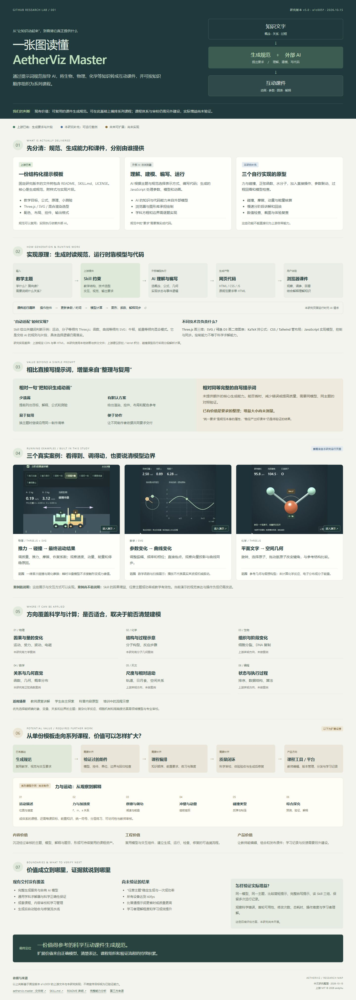
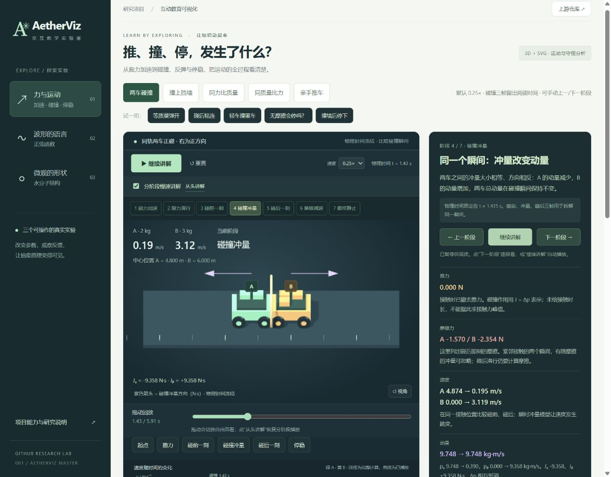

# 001 · AetherViz Master 课件生成规范研究

源库：[aetherviz-master](https://github.com/andyhuo520/aetherviz-master)。通过提示词规范指导外部 AI 生成生物、物理、化学等学科的互动课件，把文字知识转成动画、参数操作、图表和讲解；也可按知识顺序组织为系列课程。本项目整理其能力与原理，并制作三个可运行的研究案例。

**我们的理解：**它的核心是提示词控制与制作规范，把教学结构、技术选择和交互要求预先整理好。系列课程可以在此基础上逐课生成、统一风格并编排，但知识顺序、前置要求、练习与科学审核仍需另外设计。

**当前研究判断：上游的主要价值是课件生成规范与提示模板。当前碰撞、摩擦、能量核算和分阶段讲解由本研究额外编写；演示效果仍有不足，尚未证明使用该 Skill 相比普通提示词能稳定提质或省时。**详见[价值与能力判断](capabilities.md)及[效果复查](interaction-review.md)。

## 一张图读懂这个库

[打开网页总览](web/overview.html) · [查看完整长图](web/assets/overview/research-map.jpg)。网页可阅读、点击案例进入演示、保存整张图，或通过浏览器打印为 PDF。

总览覆盖实际交付、生成与运行原理、相对提示词的增量、三个真实案例、六个声明适用方向、系列课程与产品扩展路线，以及能力边界和待验证结果。明确区分上游已有内容、本研究补充实现与未来设想。



| 项目资料 | 内容 |
| --- | --- |
| 源库 | [aetherviz-master](https://github.com/andyhuo520/aetherviz-master) |
| 研究版本 | [`a1c005f86e9aca18e75917bd5eb38f454bd24a68`](https://github.com/andyhuo520/aetherviz-master/tree/a1c005f86e9aca18e75917bd5eb38f454bd24a68)，Skill v5.0 |
| 研究日期 | 2026-10-15 |
| 研究状态 | 资料与三个研究案例已整理；演示呈现仍需改进，未验证 Skill 的相对增益；见[研究笔记](notes.md) |
| 上游许可证 | MIT，Copyright (c) 2026 andyhu，原文见 [LICENSE](references/upstream-LICENSE) |
| 在线地址 | 尚未发布；`projects.json` 的 `demo_url` 保持为空 |

## 先看真实演示

在仓库根目录运行：

```sh
python -m http.server 8080 --bind 127.0.0.1
```

打开：<http://127.0.0.1:8080/projects/001-aetherviz-master/web/>

浏览器依赖已经随项目保存，运行不需要安装 npm 包、调用 AI API 或连接 CDN。也可以直接用现代浏览器打开 [web/index.html](web/index.html)；HTTP 方式更方便检查资源与部署路径。

| 演示 | 实际交互 | 用来验证的能力 |
| --- | --- | --- |
| [01 · 力、碰撞与停稳](web/index.html#newton) | 施力、撤力、两车碰撞或撞墙、反弹/粘连、摩擦停稳；碰前/碰后回看 | 分段解析运动、冲量与动量、能量账、完整过程与事件回放 |
| [02 · 正弦函数](web/index.html#sine) | 直接拖橙点改变相位、拖绿点改变振幅；与原始虚线比较；点选频率预设 | 图形与参数双向联动、动态采样、SVG 直接操作 |
| [03 · 水分子结构](web/index.html#molecule) | 直接拖氢原子改变键角；拖背景旋转；一键恢复参考结构 | 三维射线拾取、拖动平面、几何联动与模型边界 |

每个案例都包含学习目标、原理解释、模型假设和可折叠的小测验。水分子参考几何取自 NIST：O–H 键长 0.958 Å，H–O–H 键角约 104.5°；改变键角只是几何探索。



截图由本项目本地浏览器实际运行产生。更多画面：[正弦函数](assets/sine.jpg) · [水分子](assets/molecule.jpg) · [手机尺寸布局](assets/mobile.jpg)。

## 第二轮交互改造

首版过于依赖滑块与读数，小车太小，窄窗口的控制区还会被排到画布下方。另发现动画首帧时间差可能为负，造成循环中断。现已修复启动问题，放大主体、把操作区移到上方，并实现上表中的直接操作与过程回放。默认自动演示可暂停；系统要求减少动态效果时，默认保持暂停。

此前问题与验证见[交互体验复查](interaction-review.md)。现已进一步扩展碰撞实验。

## 第三轮：重点分析碰撞与最终停止

默认进入“施力加速—撤力滑行—碰撞—碰后运动—摩擦停稳”。可调推力、双方质量、施力时长、恢复系数与摩擦；提供等质量弹开、粘连、轻车撞重车、无摩擦和撞墙五个预设。

用「碰前一刻 / 碰后一刻 / 停稳」比较同一接触时刻的速度、动量、动能，以及最终位置。速度与力图、冲量标记和能量去向联动。无摩擦时明确保留运动，墙的外部冲量单独解释。完整公式、假设、默认数值与验证见[碰撞完整分析](collision-analysis.md)。

## 第四轮：放慢并分阶段讲清楚

默认 0.25× 讲解，接触前局部降至 0.1×；依次讲施力、撤力、碰前、冲量、碰后、减速和最终结果。每段同时解释推力、摩擦、速度、动量、能量，并支持上一/下一阶段。碰撞三帧固定在同一物理时刻，阅读停留不代表碰撞持续时间；紫色箭头表示冲量。最后区分摩擦停稳、墙的冲量阻停与无摩擦继续运动。桌面讲解与画面并排，小屏把说明放在画布下方。

## 对上游的核心判断

上游当前只有说明文档、许可证与 `SKILL.md`。它提供的是 **AI 生成课件的规范**：让外部模型按约定写网页，而不是自带完整生成服务或学科仿真程序。

工作链路是：**教学主题 → AI 读取 Skill → 生成 HTML/CSS/JavaScript → 浏览器运行课件**。Skill 规定 Three.js、SVG、KaTeX、布局、配色和交互；真正的公式、模型和事件处理仍由生成的代码负责。

三个案例是读取该规范后完成并校验的研究实现。它们证明这些展示方式可以实现，不能据此认定“任意主题一次生成成功”“科学模型自动正确”或“所有设备达到 60fps”。

## 研究导航

- [能力、原理与场景详解](capabilities.md)：逐项区分上游要求、实际实现和能力边界。
- [研究笔记与验证记录](notes.md)：运行环境、测试输入、观察结果和发现的问题。
- [碰撞完整分析](collision-analysis.md)：施力、接触、反弹/粘连、摩擦停稳及能量核算。
- [Web 运行与构建](web/README.md)：本地使用、依赖更新、Pages 子路径和发布步骤。
- [实验生成提示词](prompts.md)：三个案例的要求与复现输入。
- [第三方来源与许可证](THIRD_PARTY.md)：上游快照、依赖、数据与截图来源。

## 与上游输出约定的差异

为方便离线运行和源码阅读，本研究把三个课件合并到一个实验室入口，并拆分共享样式、逻辑与依赖；使用原生 CSS 和官方 OrbitControls。上游要求的 CDN、单 HTML 输出和内联简化 OrbitControls 未逐字沿用。力学用分段解析方程、首次一维碰撞冲量与摩擦模型，碰撞模式可回看完整计算；旧有无摩擦玩法支持实时改力与历史回放。没有使用通用物理引擎。
