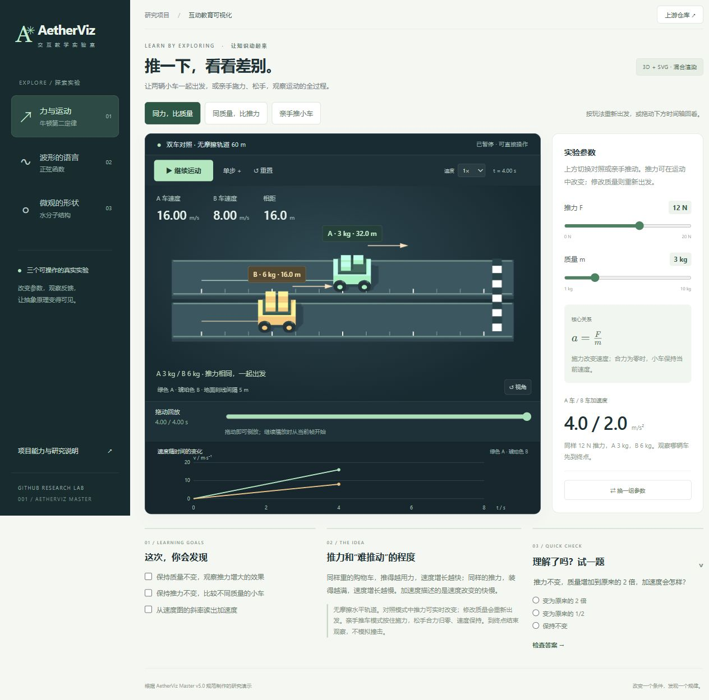
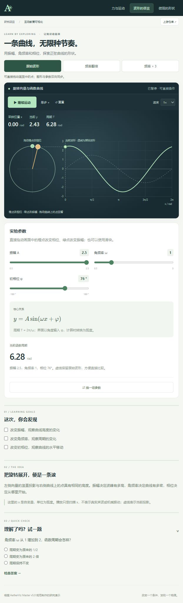
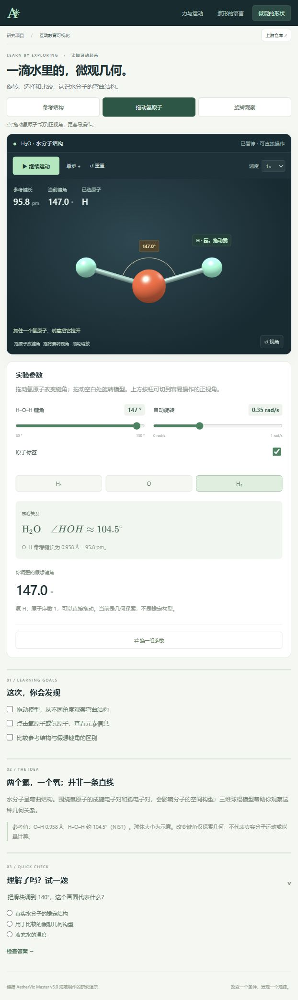

# 能力、实现原理与适用场景

图解入口：[研究总览网页](web/overview.html) · [完整长图](web/assets/overview/research-map.jpg)。将本页结论、实际案例和后续扩展路线汇总，并标注上游、本研究与未来设想的贡献边界。

## 我们的理解

源库 [aetherviz-master](https://github.com/andyhuo520/aetherviz-master) 通过提示词规范指导外部 AI 生成生物、物理、化学等互动课件。它把文字知识转成动画、参数操作、图表和讲解；可以沿统一规范逐课生成，再按知识顺序组织成系列课程。现有交付的核心是提示词控制，完整课程的前置知识、递进顺序、练习和内容审核需要另外建设。

## 研究判断：参考价值明确，直接落地与增益证据有限

2026-10-15 重新核对上游文件树及当前演示后，价值判断如下：

| 评估对象 | 当前判断 | 依据与限制 |
| --- | --- | --- |
| 课件生成需求模板 | 有参考价值 | 把教学目标、公式、测验、参数与图形联动等要求写成可重复使用的约束，含配色和代码片段 |
| 拿来即用的课件产品 | 交付不足 | 上游只有 README、Skill、许可证；没有可运行的完整应用、主题题库或内容审校流程 |
| 可复用的学科仿真核心 | 未提供 | Three.js 负责绘制；学科方程、碰撞、摩擦、能量与边界仍需另行实现 |
| 稳定生成高质量演示 | 尚无充分证据 | 本研究尚未做相同模型、相同主题的有/无 Skill 对照；不能量化省时或质量提升 |
| 当前研究案例 | 自行实现的可运行原型 | 碰撞求解、过程回放、分阶段讲解与数值测试由本研究额外编写；用户反馈演示效果仍不足 |

**适合将其收录为“AI 课件生成规范参考”。当前证据不足以将其定位为成熟教学仿真框架。**这是基于交付内容和本轮观察作出的研究判断，不是对所有模型或主题生成质量的统计结论。

本轮案例只能证明这些交互可以实现。实现成功不能自动归因于 Skill；当前呈现效果不好也不能直接作为该 Skill 的对照实验结论。需要独立测量使用和不使用 Skill 时的首轮可用性、科学错误、修改轮数、制作耗时与教学可理解性。

效果复查与当前问题见[交互体验复查](interaction-review.md)。不应以增加按钮、放慢动画或数值测试通过的数量代替效果验收。

## 1. 项目交付什么

研究版本的上游文件树只有 `README.md`、`SKILL.md` 和 `LICENSE`，未提供网页入口、服务端、模型权重、测试集或成套教学内容。核心资产是 [SKILL.md](references/upstream-SKILL.md)：约定外部 AI 如何把主题编写成互动课件。

| 层次 | 由谁提供 | 本项目如何验证 |
| --- | --- | --- |
| 生成规范 | 上游 Skill：布局、技术栈、配色、教学结构、交互约束 | 阅读固定版本原文 |
| 生成能力 | 外部 AI：理解主题、选择模型、写代码 | 本轮没有跨模型或批量成功率测评 |
| 课件运行能力 | 生成网页的 JavaScript 与浏览器 | 制作并实际运行三个固定案例 |

README 中的“一键生成”“60fps”“任意主题”是目标或宣传描述，不能从一份 Markdown 规范直接推导稳定性、精度和性能。

## 2. 能力对照

| 上游要求 | 实现机制 | 本轮实证 | 边界 |
| --- | --- | --- | --- |
| 学科适配 | AI 按主题、关键词或语义选择渲染与配色 | 物理、数学、化学三个预定主题 | 网页没有在线主题识别器 |
| 三维展示 | Three.js 场景、相机、网格、灯光和材质 | 小车轨道、水分子模型 | 画面不等于科学模型正确 |
| 二维图表 | SVG 路径、坐标、标注；D3 可选 | 正弦曲线、速度时间图 | 此处直接操作 SVG，未引入 D3 |
| 混合渲染 | 图层共享参数；三维坐标投影 | 小车、标签和速度图联动 | 同步逻辑需由代码实现 |
| 参数动画 | 事件、状态、动画帧与计算模型 | 力、质量、振幅、频率、相位、键角 | 每个主题仍需专门建模 |
| 相机与拾取 | OrbitControls、Raycaster | 旋转缩放、点击原子与按钮选择 | 真机双指操作未验证 |
| 教学结构 | 按要求输出目标、解释、小测验 | 每课均有目标、假设、测验 | 固定题目，无自适应学习系统 |
| 公式显示 | KaTeX 排版 | 三课核心公式 | 不验证公式正确性 |
| 单 HTML | 内联脚本与样式 | 本研究拆分共享文件 | 原规范要求 CDN，不能直接声称离线 |

## 3. 生成与运行原理

**生成阶段**：主题 → AI 读取 Skill → 确定概念、公式、几何与交互 → 编写网页。Skill 通过具体约束减少输出随意性，没有训练新模型或提供推理引擎。

**运行阶段**：控件改变参数 → 更新状态 → 计算模型 → 更新 Three.js 对象、SVG 路径和文本 → 浏览器绘制。本页运行时没有 AI 请求。

### 三维与二维同步

三维物体位置经相机投影后，映射到画布像素：

```text
世界坐标 (x, y, z) → 相机投影
屏幕 x = (投影 x × 0.5 + 0.5) × 宽度
屏幕 y = (−投影 y × 0.5 + 0.5) × 高度
```

小车力标签使用该机制，旋转相机后仍跟随物体。速度图与小车由同一份参数和时间驱动。

### 物理模拟边界

上游建议 AI 内联欧拉法或 Verlet 积分，但没有提供学科方程或力学引擎。积分只决定如何推进方程，不能替代正确的方程、单位和边界条件。

本研究的对照与亲推模式按每段恒定推力的解析关系推进：`v新 = v旧 + aΔt`、`s新 = s旧 + v旧Δt + ½aΔt²`。改变推力不会重算过去或清空现有速度；无摩擦时松手后 a = 0，保留速度。碰撞模式另外加入一维接触解析时刻、恢复系数、冲量和摩擦停稳模型，完整时间轴可按事件回看。复杂多体碰撞、接触形变、真实化学反应仍需专门建模。

## 4. 三个实际案例

### 牛顿第二定律：混合渲染

默认主实验现为**施力—撤力—碰撞—碰后滑行—停稳**。支持两车碰撞与固定墙、六个可调参数、五个预设、碰前/碰后/停稳跳转、速度与力图、动量和能量账。默认 12 N、2/3 kg、e = 0.6、μ = 0.08，接触约 1.435 s、全部停稳约 5.409 s。无摩擦粘连后继续运动，撞墙时说明外部冲量。详细关系与限制见[碰撞完整分析](collision-analysis.md)。

以下旧有无摩擦对照和亲推玩法仍可切换：

- 输入：推力 12 N，质量 3 kg，从静止出发。
- 模型：`a = F/m`，每段恒力内按解析方程推进；仅在从静止出发且推力恒定时，可简写为 `v = at`、`s = ½at²`。
- 对照：2 s 时 a = 4 m/s²、v = 8 m/s、s = 8 m。
- 操作：两车相同推力、质量 3 / 6 kg；4 秒时位置 32 / 16 m。也可切换到同质量不同推力、按住施力松手滑行、拖动记录的时间轴回看。
- 用途：控制变量实验、观察运动、读取速度图斜率。
- 限制：无摩擦、无空气阻力；修改质量会重开。对照最多观察 8 秒、手动最多 12 秒，终点只结束观察，不模拟碰撞。



### 正弦函数：二维 SVG

- 模型：`y = A sin(ωx + φ)`，周期 `T = 2π/ω`。
- 操作：滑块或直接拖动绿色、橙色控制点改变 A、φ；点击预设改变 ω；虚线保留原始波形供对照。
- 对照：ω = 3 时周期约 2.09 rad，ω 翻倍时周期减半。
- 左侧旋转向量与右侧采样点具有相同的竖直投影。
- 用途：函数图像、波形参数与数学直觉。
- 限制：播放只是扫描自变量，不冒充物理波动实验。



### 水分子：三维结构

- 参考：O–H 0.958 Å，H–O–H 约 104.5°。
- 模型：按参考坐标放置氧、氢并连接球棍。
- 操作：直接拖动氢原子，键角与两条键同步变化；拖空白处旋转，按钮切正视角与参考构型。
- 对照：150° 必须标为假想构型，重置恢复参考值。
- 用途：结构识读、空间几何与化学模型意识。
- 限制：球半径仅示意，未计算电子密度、能量、键振动与反应。



数据来源：[NIST 实验几何列表](https://cccbdb.nist.gov/expgeom2x.asp?casno=7732185)。原表夹角为 104.4776°，演示采用教学近似 104.5°。

## 5. 使用场景

| 场景 | 使用方式 | 重点检查 |
| --- | --- | --- |
| 教师备课 | 为单个知识点生成短实验 | 学段、公式、单位、对照条件 |
| 学生自学 | 改变一个参数，预测后观察 | 边界和解释，避免误导 |
| 科普内容 | 用结构和动画补充文字 | 简化假设、小屏可读性 |
| 教育产品原型 | 验证课件布局与交互 | 后续内容审校、兼容与性能 |
| AI 工作流研究 | 借鉴目标、技术约束和验收规范 | 模型版本、重复实验、错误分类 |

使用上游时，先在支持 Skill 的 AI 编程环境中加载 `SKILL.md`，再提供主题、学段和要验证的关系。仅克隆仓库并启动静态服务器不会出现生成器，Skill 的安装注册方式由使用环境决定。

适合先选可解析、可核对的小主题。工程精度、多物理场、真实反应预测或完整课程管理平台还需要专门模型、数据和应用工程。

## 6. 未验证项

任意主题的一次生成成功率、跨模型表现、全设备 60fps、复杂场景压力、真实手机触控、学习效果提升、自适应教学、账号与多人协作、线上部署均不属于本轮已验证结论。

## 依据

- [固定版本 Skill](https://github.com/andyhuo520/aetherviz-master/blob/a1c005f86e9aca18e75917bd5eb38f454bd24a68/SKILL.md)：技术栈、混合渲染、教学与输出要求。
- [固定版本 README](https://github.com/andyhuo520/aetherviz-master/blob/a1c005f86e9aca18e75917bd5eb38f454bd24a68/README.md)：定位与声明的主题领域。
- [固定文件树](https://github.com/andyhuo520/aetherviz-master/tree/a1c005f86e9aca18e75917bd5eb38f454bd24a68)：实际交付内容。
- [本项目计算模型](web/models.js)与[页面实现](web/app.js)：案例运行依据。
