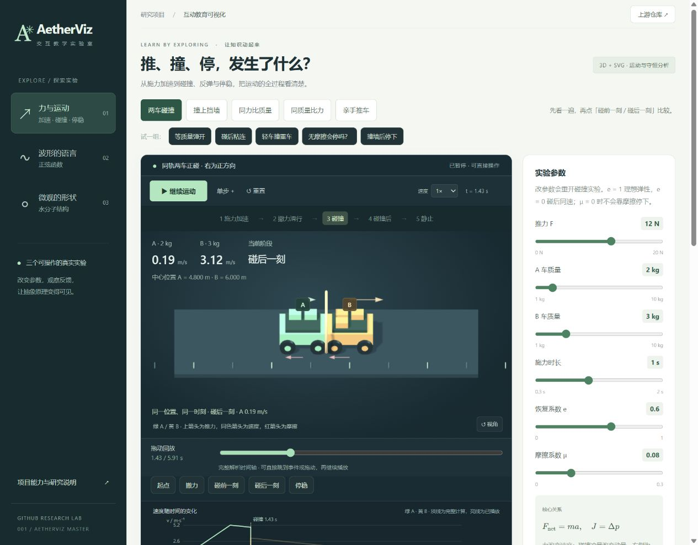

# 从推力到碰撞、停稳的完整力学实验

入口为 `web/#newton`。这是按上游教学规范编写的研究实现，上游仓库没有提供碰撞求解器。页面默认进入两车碰撞，保留此前的双车控制变量与亲手推车玩法。

## 可以怎样操作

1. 默认进入 **0.25× 分阶段慢速讲解**，接触前最后 0.2 个物理秒进一步降至 0.1×。默认条件下依次讲施力加速、撤力滑行、碰前、冲量、碰后、摩擦减速、最终静止；没有碰撞或撞墙直接停止时跳过不适用阶段。
2. “碰前—冲量—碰后”固定在同一个精确接触时刻，分别停留 6 / 8 / 6 个现实秒用于阅读，不代表碰撞持续这些时间。紫色箭头单独标出冲量方向。
3. 改变推力、A/B 质量、施力时长、恢复系数 e、有效摩擦系数 μ。每次改参数重开实验，完整时间轴和预测结果同时更新。
4. 使用“等质量弹开”“碰后粘连”“轻车撞重车”“无摩擦会停吗？”和“撞墙后停下”预设。可随时暂停，用“上一阶段 / 下一阶段”或阶段按钮逐段阅读。
5. 阶段讲解同时列出推力、摩擦力、速度、动量和能量，数值随画面更新；桌面并排显示，小屏放在画布下方。参数可在“调整实验参数”中展开。
6. 取消“分阶段慢速讲解”切换自由播放；速度可选 0.1 / 0.25 / 0.5 / 1 / 2×。拖动连续时间轴也会切到自由回看，再点“从头讲解”恢复讲解模式。自由模式保留单步。

## 各阶段要读懂什么

| 阶段 | 力、速度与动量 | 能量与停止原因 |
| --- | --- | --- |
| 施力 | 推力与摩擦的差决定加速度，外力持续改变动量 | 推力做正功，部分增加动能、部分被摩擦耗散 |
| 撤力 | 推力归零，已有速度保留；有摩擦才逐渐减速 | 推力不再做功，动能继续转成摩擦耗散 |
| 碰前 | 记录接触前的速度和总动量，B 尚未被撞动 | 记录碰前动能，作为瞬间变化的基准 |
| 冲量 | 同位置、同时刻比较前后；两车冲量相反，总动量瞬时守恒；墙则提供外部冲量 | e 决定碰后速度与动能损失，不确定接触力峰值 |
| 碰后 | 正速度向右、负速度为反弹；粘连只要求同速 | 碰后仍有动能时还会运动，不能把粘连等同于静止 |
| 减速 | 各车摩擦反向于速度，减到零的车不再承受滑动摩擦 | 摩擦做负功，继续耗尽剩余平动动能 |
| 最终 | 普通案例由摩擦的外部冲量使动量归零，地面获得相反冲量；墙 e = 0 可直接阻停 | 全部平动动能变为摩擦或碰撞耗散；无摩擦案例仍保留运动 |

慢速和阅读停留只改变展示节奏。物理接触时刻、碰前/后速度、冲量、能量账与最终停止位置不变。

[完整讲解页面截图](assets/guided-full.jpg) · [手机讲解截图](assets/guided-mobile.jpg)

## 场景与边界

- 一维、水平、仅平动。A 初始中心 x = 0，静止 B 的中心 x = 6 m；两车长度均为 1.2 m，故 A 中心抵达 4.8 m 时接触。墙的表面位于 6 m，撞墙时 A 中心抵达 5.4 m。
- 设定推力向右作用于 A，在设定时长或首次接触时撤去，以较早者为准。B 不受驱动。
- 使用同一有效摩擦系数，滑动阻力大小为 μmg；静止时用同一系数平衡较小推力。这是可核算的简化接触模型，不是对真实轮车滚动阻力的标定。
- g = 9.81 m/s²，不计空气阻力、旋转动能、形变历程、轨道边墙或材料强度。车轮旋转只是视觉提示。
- 碰撞为瞬时冲量模型，e 在 0–1 之间。e = 1 为理想弹性；e = 0 时两车同速并在本模型中保持接触。仅计算首次正碰，无需近似逐帧修正重叠。
- μ = 0 且碰后速度非零时，只暂停在接触后 6 秒的观察末端，明确保留速度；“停稳”按钮禁用。不会把观察结束伪装成物理停止。

## 分段方程

施力阶段从静止出发：

`a = max(0, F/mA − μg)`，`x = ½at²`，`v = at`。

撤力与碰后滑行使用有符号速度：

`a = −μg·sign(v)`；将这一段精确截在 `t停 = |v初|/(μg)`，之后速度为零、位置保持不变。停止前滑行距离 `d = v初²/(2μg)`。μ = 0 时匀速。

接触时刻通过恒加速或恒减速方程的正根计算。若撤力后的停止距离小于剩余间隙，则不产生碰撞。

两车碰撞前速度为 uA、uB，碰后为 vA、vB：

`mA·uA + mB·uB = mA·vA + mB·vB`

`vB − vA = e(uA − uB)`

解得：

`vA = [mA·uA + mB·uB − mB·e(uA−uB)]/(mA+mB)`

`vB = [mA·uA + mB·uB + mA·e(uA−uB)]/(mA+mB)`

墙固定时 `vA = −e·uA`。小车系统受墙的外部冲量，小车自身的动量不守恒；墙与地球接受相反冲量。

冲量 `JA = mA(vA−uA)`。两车的碰撞冲量大小相等、方向相反。页面把碰撞标为 N·s 的事件，不伪造某个 N 的力峰值：恢复系数与动量变化不能单独确定接触时长或峰值。

## 默认结果与对照

默认 F = 12 N，mA = 2 kg，mB = 3 kg，施力 1 s，e = 0.6，μ = 0.08。

| 量 | 计算值 |
| --- | --- |
| 净加速度 | 5.2152 m/s² |
| 接触时刻 | 1.434598 s |
| 碰前 A / B 速度 | 4.874128 / 0 m/s |
| 碰后 A / B 速度 | 0.194965 / 3.119442 m/s |
| 碰撞瞬间总动量（前后相同） | 9.748255 kg·m/s |
| 碰前 / 碰后总动能 | 23.757120 / 14.634386 J |
| A / B 碰撞冲量 | −9.358325 / +9.358325 N·s |
| 碰撞耗散 | 9.122734 J |
| 全部停稳时刻 | 5.409422 s |
| 停止中心位置 A / B | 4.824217 / 12.199615 m |
| 推力累计做功 | 31.291200 J |
| 最终摩擦耗散 | 22.168466 J |

保持其余默认值，将 F 改为 20 N，碰前 A 速度约 9.199 m/s，B 最终中心约 28.082 m：推力改变的结果会贯穿接触速度、冲量、动能和停止位置。这个较强推力案例在接触前仍在加速，接触即撤力。

预设检验：等质量 e = 1 时交换速度；e = 0 时两车同速；mB = 8 kg、e = 0.8 时 A 反弹；无摩擦粘连后共同保持 2.4 m/s；墙 e = 0 时在接触瞬间停下。

## 能量与图表

速度时间图显示负速度、接触时的突变及摩擦减速斜率；力图分别显示 A 推力和两车摩擦，碰撞单独标注冲量。淡线为完整解析计算，亮线表示已播放的部分。

能量账在每个回看时刻核算 `W推力 = K平动 + E摩擦 + E碰撞`。碰撞耗散按碰前与碰后总动能差计算，摩擦耗散按每辆车累计路程计算，包含反弹后的路程。它不区分热、声音和材料形变的具体比例。

## 验证与依据

- `node --test web/tests/models.test.cjs`：26 项测试，含守恒、弹性/粘连、墙外冲量、接触解析时刻、无穿透、准确停稳、能量账、边界组合，以及讲解的固定时刻、局部慢速、阶段不跳过和完整播放。
- 浏览器真实操作验证五个预设、碰前/碰后跳转、停止位置随推力改变、零推力、回放与继续播放。截图见 `assets/collision.jpg`、`assets/collision-analysis.jpg` 和 `assets/collision-mobile.jpg`。
- [OpenStax：Impulse and Collisions](https://openstax.org/books/university-physics-volume-1/pages/9-2-impulse-and-collisions)：冲量与动量变化。
- [OpenStax：Types of Collisions](https://openstax.org/books/university-physics-volume-1/pages/9-4-types-of-collisions)：碰撞类型、动量与动能，及碰后外部摩擦的区别。

