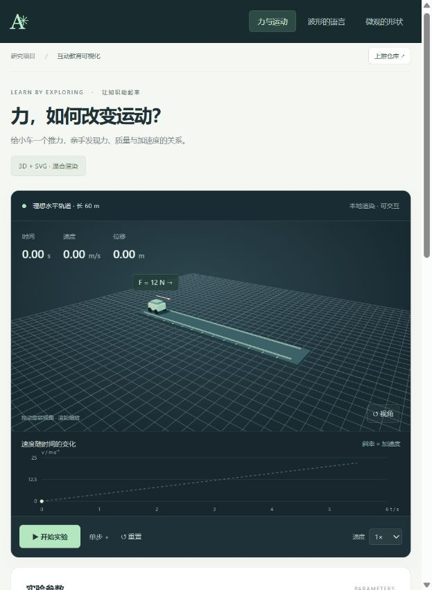
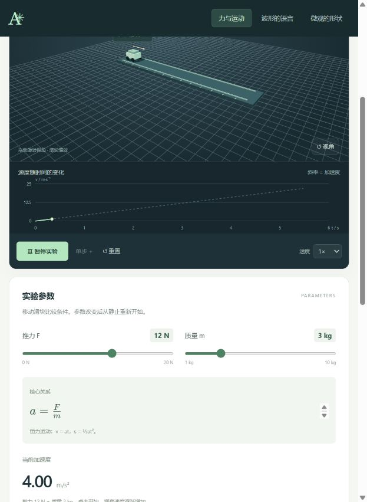
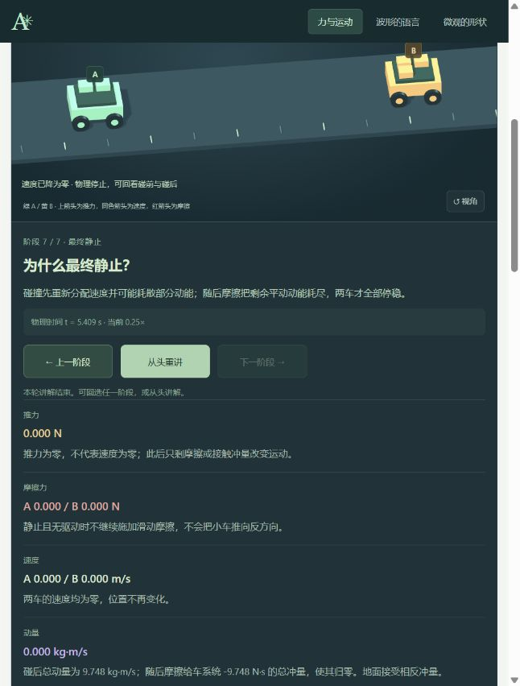
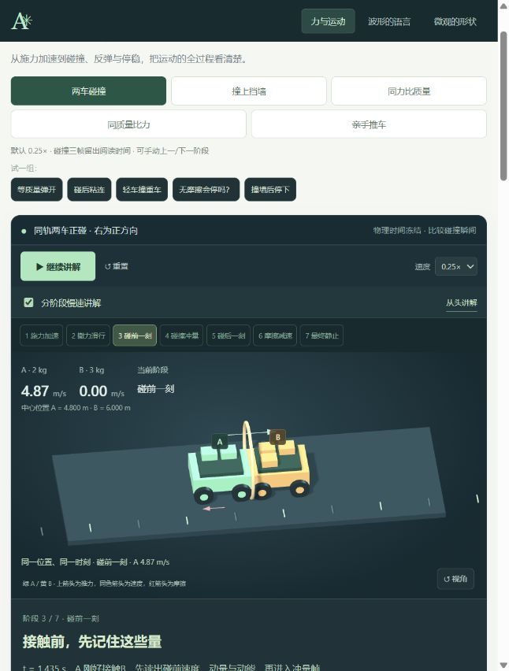
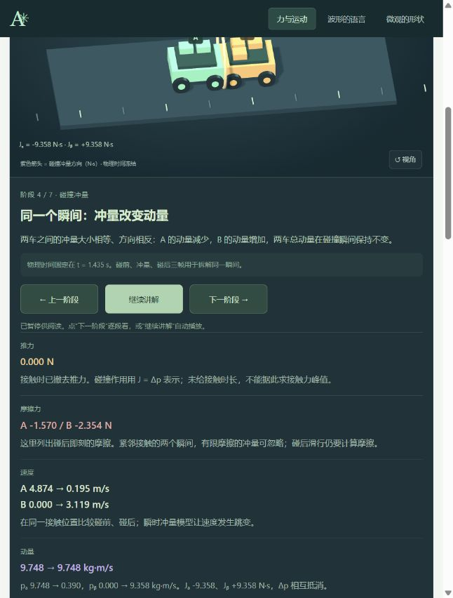
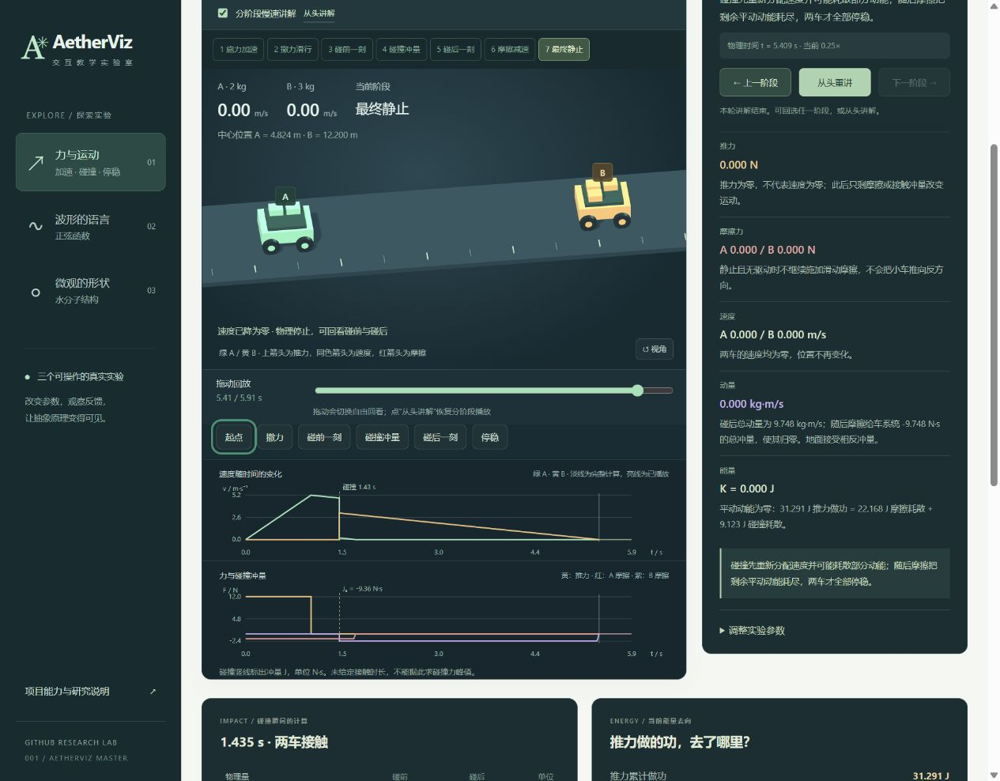
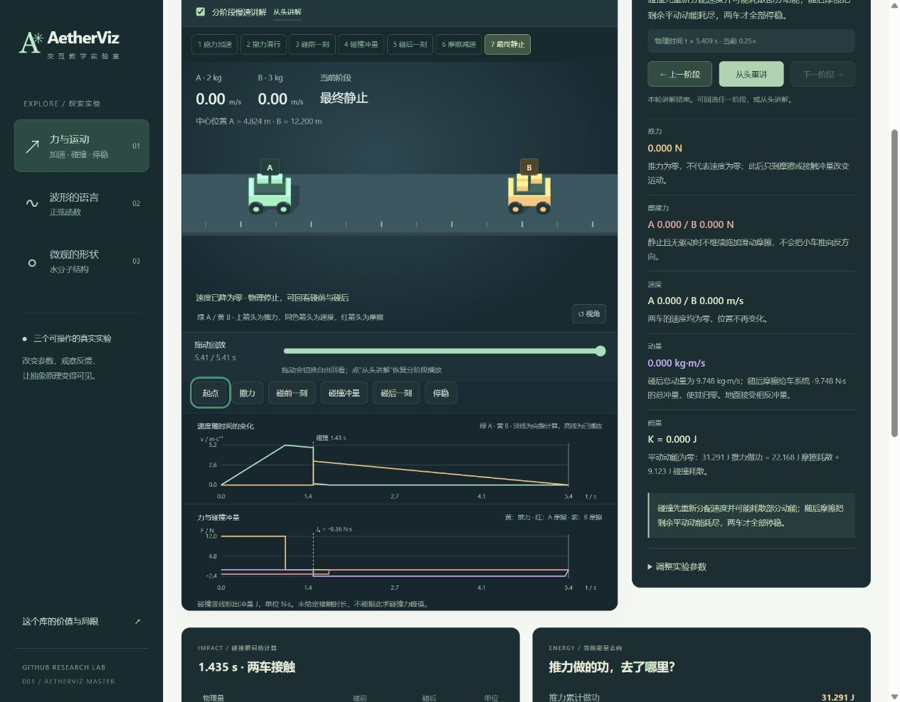
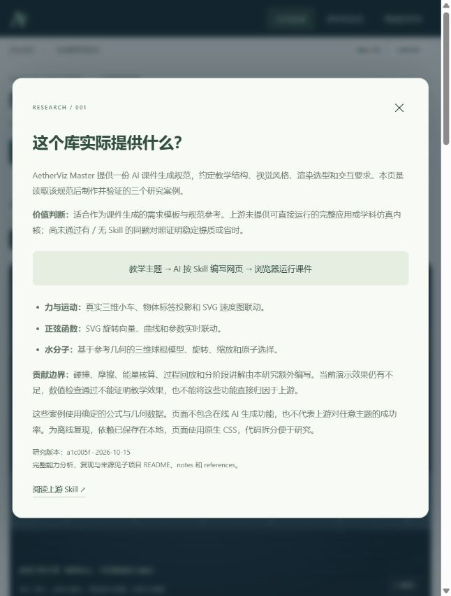

# 交互体验复查与改造记录

范围：现有三个课件的进入、操作与反馈。目标：读者能直接改变实验条件、看清过程，而不仅是读结果。检查使用当前本地页面与本轮截图，没有进行完整 WCAG 合规评估。

## 1. 进入课件：原先体验较弱，已调整

窄窗口里小车只占画布很小一块，控制区位于画布下方；默认暂停也缺少明显可操作目标。按钮和图注较小，识读、触控都有风险。

改为默认自动演示、放大两辆车、操作区上移，并直接显示三个玩法；减少动态效果设置启用时仍默认暂停。

## 2. 播放与调整：原先难以比较，现已能操作过程

首版虽然有播放与滑块，但缺少同时对照，改条件还会清空状态，读者难以观察“改变条件之后”发生了什么。复查也发现 RAF 时间戳早于初始化时间时可产生负时间步，导致动画异常后不再推进。

现在两车同时运动、各有轨迹与速度曲线；改变推力保留已有速度；可按住施力、松手观察惯性，拖时间轴查看记录。动画时间差限制在非负范围，新增启动回归检查。

## 3. 直接操作与反馈：三个案例均已实际验证

| 过程 | 当前结果 |
| --- | --- |
| 3 kg / 6 kg、相同 12 N、4 秒 | A 32 m / 16 m/s；B 16 m / 8 m/s |
| 实时改变推力 | 改之前与刚改之后速度相同；下一步才按新加速度增加 |
| 按住按钮约 1.2 秒后松开 | 实际推力显示 0，已有速度保留，位置继续增加 |
| 拖记录时间轴 | 回到 0 时位置归零；拖到末端恢复记录结果，可从该帧继续 |
| 直接拖橙点、绿点 | 相位改到 76°、振幅改到 2.5；曲线和滑块同步 |
| 直接拖水分子氢原子 | 键角从 104.5° 改到 147°，被选原子、两条键、标签和“假想构型”说明同步 |

原子拖动、函数点拖动还提供滑块替代路径，主要按钮可键盘操作。真实手机触控、屏幕阅读器完整流程、色彩对比逐项量测没有覆盖，不能据此声称全面可访问性合规。可操作课件仍是基于上游规范的研究实现，不代表任意主题自动生成成功率。

## 第五轮复查：用户仍认为演示效果不足（2026-10-15）

用户明确本轮问题是“演示效果”。范围为当前力学案例的观看、碰撞分帧与结束反馈；使用当前浏览器实际状态和本轮新截图，未以此前截图作为本轮效果证据。原型的计算检查通过不能代替教学呈现验收。

### 步骤 1：查看当前停止画面与讲解——可读，但呈现不足

画面与五类量的长段解释纵向排列，读者需要滚动才能读全；阅读文字时不能完整看到小车。增加说明之后仍主要依赖文字传达因果。用户当前视角已经旋转，截图保留了该状态，没有为取图重置。

### 步骤 2：从碰前切到冲量帧——操作可用，碰撞过程不直观

两帧均为物理 t = 1.434597841 s、中心位置约 4.8 / 6 m。速度、箭头和文字改变，但没有可见的接触压缩、恢复或有限时长的接触演化。这符合现有瞬时冲量模型的定义，却不能满足“直观看清接触过程”的效果预期。继续延长停留时间不能补上这类视觉表达。

阶段条、事件按钮、上一/下一阶段、重复的继续/重讲入口并存，操作量增加。截图也显示点击讲解区的下一阶段会滚动到讲解区，窄窗口下小车部分离开可视范围。重要的速度、动量与能量变化缺少紧邻主体的图形对照。

### 步骤 3：查看讲解结束——发现反馈不一致，已修正

默认讲解停在 5.409 s，时间轴却采用含 0.5 s 静止尾段的 5.909 s，导致显示 `5.41 / 5.91 s`、进度约 91.5%。这会使“本轮结束”的状态看起来没有完成。

现统一使用最后讲解阶段对应的物理终点。浏览器确认讲解和自由回看均显示 `5.41 / 5.41 s`、进度 100%；无摩擦仍为 `7.30 / 7.30 s`，速度保留 2.4 m/s。没有通过归零速度伪造停止。

### 本轮判断与边界

- 效果问题仍存在：长解释、重复控制与定格接触帧尚未构成直观的教学动画。本轮只修复确认的终点问题，没有将其描述为视觉改造完成。
- 可访问性风险：小字号、滚动阅读与自动变化的内容需要进一步验证；本轮没有读屏、真机触控和完整对比度测量。
- 研究归因：物理模型、回放和讲解为本项目额外开发。当前案例既不能证明上游稳定生成好课件，也不能替代有/无 Skill 的对照评估。
- 上游价值结论已在 [capabilities.md](capabilities.md) 与首页明确：规范参考有价值，成熟仿真产品交付和相对增益证据不足。

当前网页顶部增加窄窗口也可使用的“库的价值”入口，说明上游规范、本研究额外开发和未验证增益的区别。390 px 宽检查无横向溢出，说明弹窗可打开与关闭。

建议后续先用同一模型和同一主题做有/无 Skill 的受控对照，评价初稿质量、科学错误和修改成本；若继续开发教学演示，应单独确定可观察的学习目标，减少同屏概念与操作入口。
