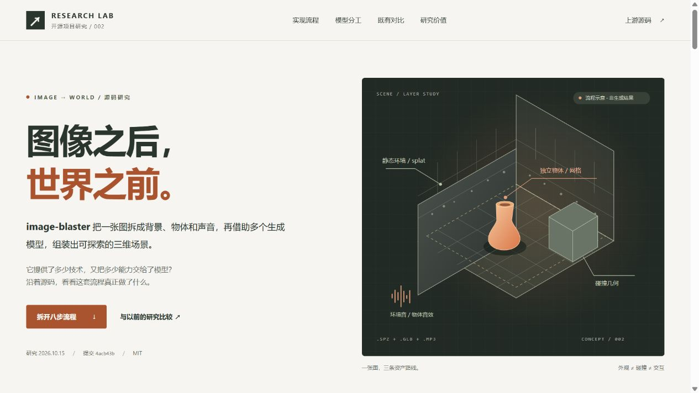

# 002 · image-blaster 图生三维工作流研究

image-blaster 把场景图中的背景与可操作物体分开，借助外部模型分别生成环境、独立三维网格与声音，再加载到网页中组合和编辑。核心生成来自外部模型；库的工程价值在资产解耦、请求恢复、本地版本管理与局部返工。

[](web/assets/image-blaster-overview-v1.png)

引导图由我们生成，房间配图依据本地预制演示重新排版，用于解释机制，并非上游模型生成效果。

| 项目资料 | 内容 |
| --- | --- |
| 上游仓库 | [neilsonnn/image-blaster](https://github.com/neilsonnn/image-blaster) |
| 研究版本 | [`4acb43ba126a12358f71838d1b1a05e856b10eaf`](https://github.com/neilsonnn/image-blaster/tree/4acb43ba126a12358f71838d1b1a05e856b10eaf) |
| 研究日期 | 2026-10-15 |
| 上游许可证 | MIT，Copyright (c) 2026 Neilson Koerner-Safrata，见 [原文](references/upstream-LICENSE) |
| 本轮范围 | 固定版本源码研究、既有项目对比、静态研究网页及浏览器验证 |
| 验证边界 | 未提交 World Labs / FAL 生成请求，未测量生成质量、费用或成功率 |
| 在线地址 | 未部署；`projects.json` 的 `demo_url` 保持为空 |

## 查看研究网页

在仓库根目录执行：

```sh
python scripts/projects.py check
python scripts/build_web.py
python -m http.server 8082 --bind 127.0.0.1 --directory _site
```

打开 <http://127.0.0.1:8082/projects/002-image-blaster/>。这是本地研究网页地址，不是已发布的线上演示。

页面包含房间拆分与组合的四步交互演示、八步源码流程、模型分工、资产与任务状态、五个项目的比较、四组逐项对照、研究价值和源码证据。网页不需要依赖安装、API 密钥或模型服务。房间参考图与三维对象均为本地预制示意，不执行真实抠图或模型生成。

房间演示依次展示完整图片、清理背景与物体参考图、分开的三维资产、组合后的场景。支持播放、逐步切换、三维旋转缩放、网格与预设布局切换、单独移动绿椅和切换花瓶版本。它用真实可操作的预制几何讲解工作流，不当作上游生成效果的证据。

## 本轮结论

一张图汇总全部研究：[查看 / 保存能力全景长图](web/assets/image-blaster-overview-v1.png)（940 × 1672，PNG）。网页“先认清它交付的是什么”区域也提供原图与下载入口。

长图覆盖能力定位、房间拆分的三条路线、模型分工、五层架构、工程价值、四项既有研究对照和适用边界。使用内置 imagegen 工具制作，房间配图依据本地预制演示重新排版，不作为上游生成效果；[完整生成提示词](web/assets/image-blaster-overview-prompt.txt)随项目保存。

image-blaster 的核心三维生成能力来自外部模型；项目自己的贡献是把场景分析、图片编辑、环境生成、单物体生成、声音和三维编辑连接起来。

可以直接理解为：**先理解和拆分图片，再分别生成背景与物体，最后组合成场景。** 独立资产方便单独移动、替换与重做；当前组合仍需人工调整位置和比例，尚未自动准确还原原图布局。网页流程区域已用房间、椅子和花瓶举例说明。

- **算法研究价值有限**：仓库没有提供自研图生三维模型或训练流程。
- **工程参考价值较明确**：静态环境与独立物体分开生成；生成脚本统一记录请求并保存本地资产；参考图和三维模型可以分别重做。
- **产品价值尚需验证**：默认布局需要编辑，缺少完整视觉与几何质检；“能生成”还不能证明稳定降低了制作成本。

## 与以前研究的关系

| 既有研究 | 比较重点 |
| --- | --- |
| 本仓库 001 AetherViz Master | Skill 指导写课件代码，与 Skill 调用生成模型的区别 |
| 1014 仓库 007 Atlas / 月门水庭 | 图片指导 Blender 代码建模，与专用模型直接生成资产的区别 |
| 1014 仓库 011 ancient-rap-battle | 多模型制作流程的任务拆分、检查、候选版本与返工 |
| 1014 仓库 006 随机门 | 场景资产生产，与故事、随机、记忆和回访等体验层的区别 |

后三项是来自以前研究记录的对比，其中月门水庭与随机门包含本地原创实验，不能统一称为上游库已实现的能力。来源与版本见 [比较分析](comparison.md) 和 [既有研究取证记录](references/prior-research.md)。

## 原理与可扩展方向

主流程由 Claude Code 按 Rules / Skills 理解画面和调度任务，JavaScript 脚本提交并轮询外部服务，将模型资产、来源与请求状态存入本地文件。网页用 React / Three.js 组合场景，Spark 显示高斯外观，Rapier 提供刚体与碰撞。环境外观与碰撞网格分离，物体参考图与模型也可分别重做；布局仍需人工调整，不能当作精确三维重建。

可继续探索质量验收、深度与尺度辅助布局、费用和任务面板、Blender 代码与生成网格混合建模，以及叙事互动和在线协作。建议先实测一个背景与一个物体，记录成功率、费用、修整时间和返工范围，再判断投入方向。这些是研究建议，尚未实现；详细设计与验收方式见 [扩展路线](extensions.md)。

## 研究导航

- [能力与适用场景](capabilities.md)
- [架构与模型分工](architecture.md)
- [比较与价值判断](comparison.md)
- [可扩展方向与验收方法](extensions.md)
- [验证记录](notes.md)
- [网页运行说明](web/README.md)
- [来源与许可](THIRD_PARTY.md)
- [源码证据索引](references/sources.json)



截图展示本研究网页，不是 World Labs 或 FAL 的生成结果。更多画面：[流程](assets/pipeline.jpg) · [比较](assets/comparison.jpg) · [手机布局](assets/mobile.jpg)。

房间交互演示截图：[完整参考图](assets/room-demo-source.jpg) · [背景与物体拆分](assets/room-demo-split.jpg) · [组合后独立编辑](assets/room-demo-combined.jpg) · [手机](assets/room-demo-mobile.jpg)。
