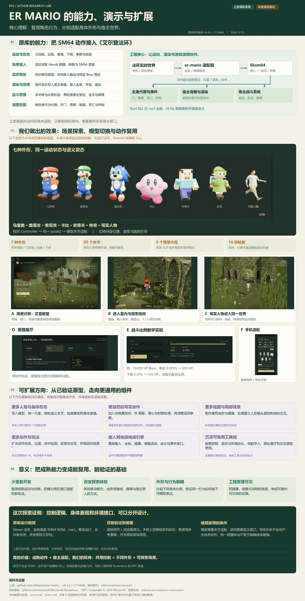
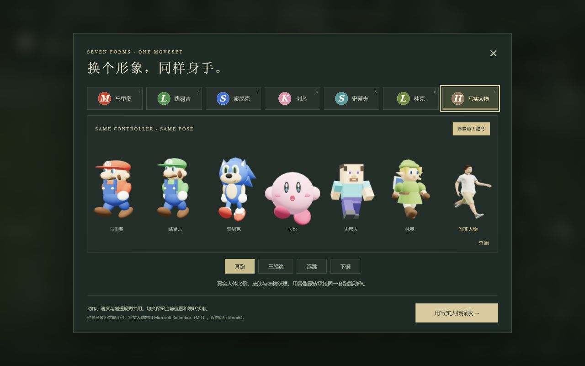

# 003 · ER Mario 跨游戏动作系统研究

**复用成熟角色行为，分别适配身体外形与宿主世界。** er-mario 将 libsm64 的《超级马里奥 64》运动与动画接入《艾尔登法环》。本研究用中文总览、机制展厅和可操作场景解释这种连接，并用七种人物外形演示动作控制与模型表现的分离。

[进入一图总览](web/overview.html) · [七人物 × 艾雷教堂试玩](web/elleh/index.html?character=human&compare=all) · [原理与战斗展厅](web/index.html)

[](web/overview.html)

总览图嵌入七张本地运行截图：[高清 PNG](assets/er-mario-overview.png) · [可放大、文字可编辑的 SVG](assets/er-mario-overview.svg)。

| 项目资料 | 内容 |
| --- | --- |
| 上游仓库 | [deltarooo/er-mario](https://github.com/deltarooo/er-mario) |
| 固定版本 | [v0.4.2](https://github.com/deltarooo/er-mario/releases/tag/v0.4.2)，提交 [11744b855bf546ca0b66dfd09068858feaa18d0e](https://github.com/deltarooo/er-mario/tree/11744b855bf546ca0b66dfd09068858feaa18d0e) |
| 研究日期 | 2026-10-15 |
| 本轮范围 | 源码研究、总览图、机制展厅、艾雷教堂局部重建、七人物动作对比与浏览器验证 |
| 验证边界 | 未运行法环、SM64 ROM、libsm64 或模组 DLL；本地截图不代表模组实机效果 |
| 来源许可 | 上游 er-mario 代码 MIT（Copyright © 2026 Delta），libsm64 CC0；写实模型 Microsoft Rocketbox MIT；详见 [来源与许可](THIRD_PARTY.md) |
| 在线地址 | [研究总览](https://yydshly.github.io/1015_codex_project/projects/003-er-mario/overview.html) · [七人物试玩](https://yydshly.github.io/1015_codex_project/projects/003-er-mario/elleh/?character=human&compare=all) · [机制展厅](https://yydshly.github.io/1015_codex_project/projects/003-er-mario/) |

## 库的能力与原理

er-mario 是面向法环的游戏模组。libsm64 提供成熟的运动与动画，er-mario 的主要工程贡献是把这些能力接入法环的实时地形、角色骨骼、战斗与游戏事件。

| 能力 | 实际连接的内容 |
| --- | --- |
| 原作动作 | 三段跳、远跳、蹬墙、下砸，以及拳脚和踩踏 |
| 环境碰撞 | 读取法环 Havok 世界，转换坐标、尺度与表面格式；同步动态表面 |
| 角色显示 | 将 SM64 身体部件姿态写入宿主骨骼，接入血条、声音与镜头 |
| 战斗流程 | 把命中转成比例扣血，再衔接法环原生受击、击杀和掉落；包含搬运及特定 Boss 甩投 |
| 游戏流程 | 以褪色者作为代理，在开门、爬梯、赐福等事件间处理控制权，并衔接死亡与存档 |

工作关系可以概括为：**法环碰撞与输入 → er-mario 适配 → libsm64 运动/动画 → 主角代理、骨骼显示和战斗结果**。运动逻辑以 30 Hz 更新，显示位置通过插值衔接。[实现原理与源码导航](architecture.md)记录了坐标转换、动态表面、骨骼和控制权的具体来源。

**它提供的是针对法环完成适配的实例。迁移到另一款游戏仍需重做宿主接口，更换任意人物也需处理模型与骨骼。**

## 我们的演示效果

本地演示没有运行上游模组或 libsm64。机制展厅用原创轨迹与数学模型解释源码；艾雷教堂试玩使用自实现运动控制器、碰撞处理与共用姿态接口。两者共同帮助理解复用方式，不能代替模组实机验证。

| 入口 | 可以体验什么 | 验证了什么 |
| --- | --- | --- |
| [一图总览](web/overview.html) | 放大查看能力、原理、效果、扩展与意义 | 用实际截图对应技术结论和验证边界 |
| [艾雷教堂试玩](web/elleh/index.html) | 移动、三段跳、远跳、蹬墙、下砸、镜头与三处地标交互 | 自实现控制器在参考场景中工作 |
| [七人物同步对比](web/elleh/index.html?character=human&compare=all) | 马里奥、路易吉、索尼克、卡比、史蒂夫、林克、写实人物同步动作，并进入教堂 | 同一运动状态和语义姿态可经适配驱动不同模型 |
| [机制与战斗展厅](web/index.html) | 五组轨迹、碰撞边线、四步原理、五种攻击比例实验 | 解释动作阶段、接口连接与源码中的伤害规则 |



七种外形共用同一个 `Controller` 和 `pose()` 接口。切换保留位置、速度、跳跃阶段与已访问地标。六个经典形象为程序重新制作的风格化几何；写实人物来自 Microsoft Rocketbox，保留纹理、蒙皮和 80 个关节，GLB 中没有动画片段，由本地共用姿态映射驱动肩、肘、髋、膝与脚。

教堂是参考钟楼、拱门、残墙、中庭、赐福与商人等空间关系制作的局部重建。场景和经典形象没有提取原游戏资产；写实人物保留外部模型来源与 MIT 许可。七种模型使用相同运动规则与碰撞体，便于对比，但不包含各自原作技能，也不代表精确身体碰撞或自然人体运动。

试玩操作：WASD / 方向键移动，Shift 奔跑，空格跳跃与连续三段跳，C + 空格远跳，空中 X 下砸，触墙后空格蹬墙，E 交互；V 打开角色面板，1–7 快切。手机提供触屏按钮；“观看导览”可访问赐福、商人和锻造台。详见 [场景与操作说明](scene.md)。

已记录 18 项动作、计算与真实模型检查通过；桌面和手机验证了移动、跳跃、模型切换、骨骼实例隔离及 3 / 3 地标导览。所有效果图均来自本地网页；作者两条 X 原帖媒体已停用，保留来源，不提供镜像或声称已播放验证。[验证记录](notes.md)

## 意义与价值

- **减少重复开发**：复用成熟运动与动画，把精力放在接口适配和新玩法。
- **改变探索体验**：不同移动能力会改变路线、越障与接近敌人的方式。
- **分离外形与行为**：同一行为可由不同身体比例和骨骼表达，便于模型替换与对比。
- **让工程原理可见**：把碰撞、坐标、骨骼和游戏流程做成可操作、可验证的教学材料。

## 六个有条件的扩展方向

| 方向 | 继续开发需要完成的工作 |
| --- | --- |
| 更多人物与身体形态 | 导入模型、统一尺度、映射语义关节，检查蒙皮与身体穿插 |
| 更自然的写实动作 | 动画重定向、IK 落脚、重心和肘膝处理，另行调整运动参数 |
| 更多地图与局部场景 | 制作建筑地形和碰撞，处理镜头遮挡与地标交互 |
| 更多动作与玩法 | 增加状态、过渡、命中、反馈和交互，并做回归检查 |
| 其他游戏或引擎 | 重做输入、坐标、碰撞、骨骼渲染、战斗和事件接口 |
| 可复用工具链 | 抽离控制、姿态与环境协议，建立模型规范、调参和自动验证 |

这些是基于当前工程的扩展方向，不是原库已具备的一键通用功能。写实外形也不会自动产生自然动作；保留马里奥式夸张能力与追求真实人体运动，需要分别设计。

## 本地打开

在仓库根目录执行：

```sh
python scripts/projects.py check
python scripts/build_web.py
python -m http.server 8083 --bind 127.0.0.1 --directory _site
```

主入口为 <http://127.0.0.1:8083/projects/003-er-mario/overview.html>，试玩位于 `/projects/003-er-mario/elleh/`，原理展厅位于 `/projects/003-er-mario/`。场景中的 GLB 通过 HTTP 加载，建议使用上述静态服务；依赖和运行资源随子项目保存，无需 npm 安装或连接 CDN。

## 上游运行条件与局限

上游需要 Steam 版法环、me3 和玩家自行提供的美版 SM64 ROM；首次启动在本机生成资源后重启。仅离线运行，关闭反作弊并使用独立存档。马里奥固定八格生命值，升级与武器属性不按法环原规则影响战斗。

v0.4.2 标为 early release；上游记录了部分升降梯穿模、过场角色变形、阴影闪烁和大型 Boss 投掷后的布娃娃问题。本轮没有验证完整通关。[固定版本说明](references/upstream-README.md)

源码研究还发现 README 对 Boss 伤害作了简化：默认拳脚比例为 **5.025%**，下砸 **3.35%**、踩踏 **2.5%**、冲撞 **1.87%**。比例扣血至少保留 1 HP，再衔接原生攻击。网页仅演示数学比例与取整，未模拟 Rust f32 误差、失衡、抗性和 Boss 脚本，不能据此推算实战击杀次数。[完整范围与源码依据](capabilities.md)

## 研究导航

- [能力与验证范围](capabilities.md)
- [实现原理](architecture.md)
- [场景与七人物适配](scene.md)
- [研究笔记与验证](notes.md)
- [网页运行与发布](web/README.md)
- [来源与许可](THIRD_PARTY.md)、[源码证据索引](references/sources.json)、[写实模型来源](references/rocketbox-source.json)
