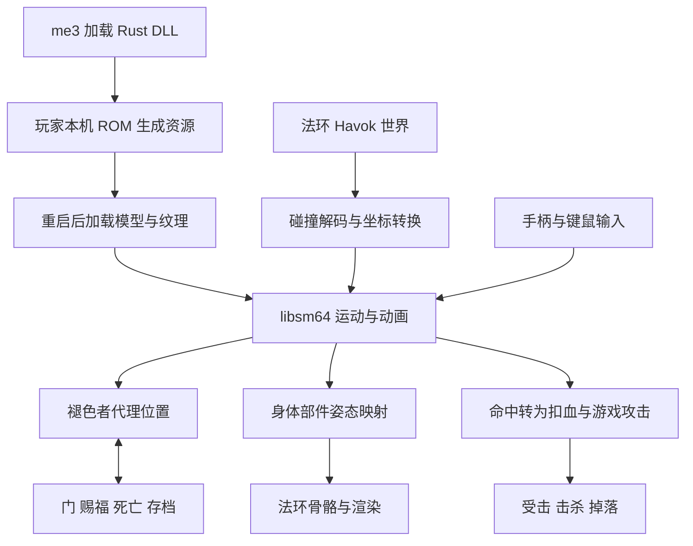
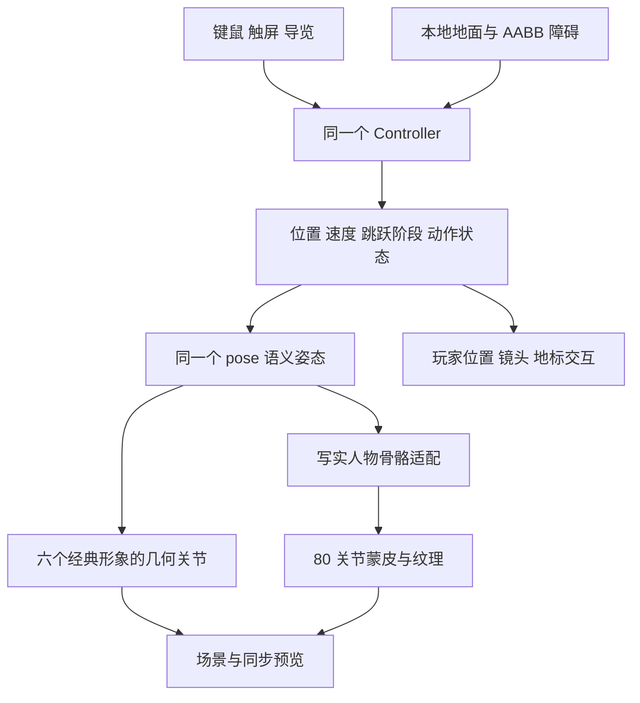

# 实现原理与源码导航

固定提交：[11744b855bf546ca0b66dfd09068858feaa18d0e](https://github.com/deltarooo/er-mario/tree/11744b855bf546ca0b66dfd09068858feaa18d0e)（v0.4.2）。[总览入口](web/overview.html)将以下两套实现分别标注：上游真实复用 libsm64 的法环适配；本地自行实现的教学与七人物对比。

## 上游：libsm64 与法环之间的适配



### 加载与资源

`Cargo.toml` 的 `cdylib` 生成动态库，由 me3 加载。`build.rs` 编译修补的 libsm64，Rust 经 `src/sm64.rs` 的 FFI 调用。`src/assets/mod.rs` 在本机用玩家提供的 ROM 生成游戏可识别的模型、纹理和菜单资源，下一次启动生效。本研究网页没有执行此流程，也没有打包 ROM 或模组 DLL。

### 世界碰撞

`src/havok_col.rs` 访问实时 Havok 世界，解码压缩网格、凸形等结构并查询附近表面。`src/lib.rs::havok_surfaces` 将结果转为 SM64 表面，并用游戏射线确认和修补地面。

`SCALE = 0.01` 米 / SM64 单位；`src/collision.rs` 处理 X 轴镜像：

```text
ER.x = origin.x - SM.x × 0.01
ER.y = origin.y + SM.y × 0.01
ER.z = origin.z + SM.z × 0.01
```

还需转换三角形绕序。`src/moving.rs` 监视物体变换，物体移动后从静态表面改为每个 tick 更新的动态表面对象。本地展厅的“碰撞线”只是原创几何边线，没有读取游戏碰撞。

### 运动与控制权

`src/lib.rs` 累积游戏时间，以 `1 / 30` 秒步长调用 `sm64_mario_tick`，显示位置用剩余时间插值。30 Hz 是运动逻辑更新频率。

自由运动时，褪色者跟随马里奥；开门、穿雾门、爬梯等游戏动画期间，由原有事件驱动，马里奥配合表现。双向控制关系用于保留游戏流程，还要处理暂停、传送、碰撞加载与场景切换。

### 骨骼与战斗

`src/engine_mario.rs` 把 SM64 身体部件映射到法环角色骨骼，在宿主动画之后、渲染之前写入模型空间姿态，并处理宿主动画覆盖姿态的时序。菜单、头像、阴影和过场需要额外适配。

`src/combat.rs` 检查拳脚、下砸与踩踏命中，先按最大 HP 比例扣血，再借游戏攻击完成受击与击杀；反方向上，褪色者损血转为马里奥血条损失。搬运和甩投见 `src/carry.rs`、`src/swing.rs`。比例与未模拟的规则见[能力说明](capabilities.md)。

这些接口依赖法环内部结构。其他游戏需要重新实现碰撞、角色、渲染、事件与战斗接口，不能将本项目理解为已完成的一键跨游戏引擎。[固定源码索引](references/sources.json)

## 本地：同一控制与姿态驱动七种外形

本地演示没有编译或运行 libsm64，也不调用法环进程。这里复用的是本地自实现控制器与姿态接口，用于说明外形、行为和环境之间如何分开适配。



### 控制、碰撞与场景

`web/elleh/controller.js` 以 1/120 秒固定步长计算加速、重力、落地、连续三段跳、远跳、蹬墙与下砸，处理本地 AABB 障碍、顶棚及墙面接触。其参数不是 SM64 实测物理，也不是 er-mario DLL 的运行输出。

`world.js` 制作参考艾雷教堂的建筑、地形、NPC、道具与植被，材质在本地生成。`game.js` 负责第三人称输入、镜头遮挡调整、自动导览、地标交互和 UI。教堂是局部参考重建，没有导入法环原版资产；赐福、商人与锻造台的交互是本地演示内容。

### 七模型与共用姿态

`characters.js` 建立马里奥、路易吉、索尼克、卡比、史蒂夫和林克六种风格化几何及统一关节接口。`pose()` 接收运动状态，输出躯干、手臂和腿的语义姿态；不同外形映射到各自肢体。`wardrobe.js` 用同一控制状态驱动七人同步预览，支持奔跑、三段跳、远跳和下砸。

写实人物来自 Microsoft Rocketbox 的 `Male_Adult_01`，转换为带纹理 GLB，保留 UV、蒙皮权重和 80 个关节；模型中没有动画片段。`human.js` 将共同姿态的肢体方向映射至原骨骼的肩、肘、髋、膝和脚，并补充肘膝弯曲。预览和场景持有独立骨骼实例，避免互相改写。

切换角色只更换可见模型，不重建玩家运动状态，因此位置、速度与跳跃阶段可继续保留。七种模型共用速度、重力、跳跃规则及碰撞体；此设计方便对比，但不保证宽体外形与墙面无穿插，也不包含角色原作技能。写实外形承接这些动作不等于自然人体运动；后者还需要重定向、IK、重心和参数设计。

模型来源、转换产物标识、80 关节与无片段事实见[来源记录](references/rocketbox-source.json)；版权与 MIT 许可保留在[来源与许可](THIRD_PARTY.md)。

### 三个网页入口与文件结构

```text
web/overview.html       总览图与能力、原理、价值、扩展入口
web/index.html          机制展厅：原创动作轨迹与数学教学
web/models.js           展厅轨迹、数学比例、坐标转换
web/app.js              展厅三维场景、播放与原理面板
web/elleh/index.html    艾雷教堂试玩与七人物对比
web/elleh/controller.js 自实现运动与碰撞处理
web/elleh/characters.js 经典形象、统一关节与共用姿态
web/elleh/human.js      写实模型骨骼适配
web/elleh/wardrobe.js   角色选择、单人预览与七人对比
web/elleh/world.js      教堂、地形、植被与地标
web/elleh/game.js       输入、镜头、交互与导览
web/assets/            写实 GLB 与模型许可
web/vendor/            Three.js、加载器、骨骼工具与许可
```

机制展厅用轨迹采样呈现五组动作；可操作教堂有独立的运动与碰撞计算，不能将两者统称为“无物理计算的轨迹”。写实模型通过本地 HTTP 加载，运行依赖随子项目保存，无需 CDN；作者原帖仅为外部来源链接，已标明媒体停用状态。

## 从具体实例扩展

本地已验证一个写实骨骼适配与七种外形共用控制的实例。继续扩展应分别处理：新人物的模型与关节适配、自然动作的重定向与 IK、新环境的地形与镜头、新玩法的状态与反馈、其他宿主的接口重做，以及通用组件所需的规范与验证工具。

价值在于减少动作重复开发、创造不同探索方式、分离外形与行为，并让接口工程可见和可测试。它尚未证明任意模型或任意游戏可以直接接入，也没有完成上游模组实机或完整通关验证。[能力与扩展范围](capabilities.md) · [本地验证记录](notes.md)
