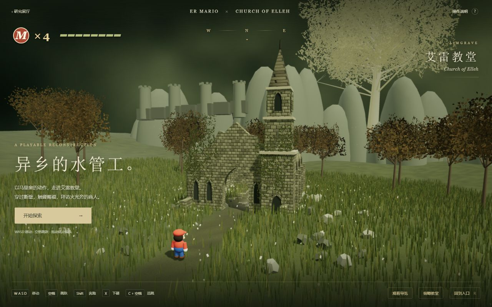

# 马里奥 × 艾雷教堂：可操作局部场景

这是参考《艾尔登法环》艾雷教堂（Church of Elleh）实机画面的浏览器重建。场景、材质与马里奥网格均重新制作，角色控制由本地代码实现。没有使用游戏原始资产，也没有运行法环或 libsm64；建筑尺度、运动参数与交互属于本演示的实现。

## 试玩

汇总构建后访问 `/projects/003-er-mario/elleh/`；源码入口为 [web/elleh/index.html](web/elleh/index.html)。

```sh
python scripts/build_web.py
python -m http.server 8083 --bind 127.0.0.1 --directory _site
```

打开 <http://127.0.0.1:8083/projects/003-er-mario/elleh/>。



## 参考对象与保留元素

- 窄高的尖顶钟楼、分层石质檐口与钟室开口。
- 教堂正面拱门、缺失屋顶、侧面破损拱墙与柱基。
- 中庭的赐福，后方靠右的商人咖列与篝火、驮兽和货物。
- 入口左侧的石座与锻造台。
- 秋色树木、荒草、远处城墙与黄金树的视觉关系。

视觉参考已在浏览器中打开核对：

1. [外观实机截图](https://eldendle.com/images/locations/church-of-elleh.jpg)：正面与侧面、钟楼、残墙、黄金树。
2. [内部实机截图](https://images.steamusercontent.com/ugc/1820021756096495704/95C5A18416EFB449FE3951F2615AC98D14F73403/)：[Steam 社区引用页](https://steamcommunity.com/sharedfiles/filedetails/?id=2764925670)，用于核对赐福、侧柱和商人之间的位置关系。

参考图为原游戏画面；未下载到产物，也未作为纹理使用。本地截图展示的是重新制作的场景。

## 操作与交互

| 操作 | 按键 |
| --- | --- |
| 移动 | WASD / 方向键 |
| 奔跑 | Shift + 移动 |
| 跳跃 / 三段跳 | 空格；保持移动，落地后快速再次起跳，连续三次 |
| 远跳 | 移动中按 C + 空格 |
| 蹬墙跳 | 腾空触墙后再次按空格 |
| 下砸 | 空中 X |
| 交互 | 接近赐福、商人或锻造台后按 E |
| 镜头 | 拖动旋转，滚轮缩放 |
| 回到入口 | R / 页面按钮 |

手机提供方向、跳跃、下砸和交互按钮。观看导览会沿入口、赐福、商人、锻造台行走；按移动键可接管。俯瞰按钮展示教堂的整体布局。

点亮赐福会显示金色发现提示；商人与锻造台提供本演示的中文场景交互。三处地标全部访问后显示完成提示。对话为原创演示文案，不是原作对白；没有商店经济、装备强化、战斗 AI、存档或完整关卡。

## 实现结构

- `web/elleh/controller.js`：独立的角色控制与 AABB 障碍、落地、顶棚和墙面接触处理。
- `web/elleh/characters.js`：六种角色的独立几何与统一关节接口，共用一个姿态函数。
- `web/elleh/wardrobe.js`：角色选择、实时动作预览、六人同步对比。
- `web/elleh/world.js`：教堂、NPC、地形和植被；所有材质由 Canvas 在本地生成。
- `web/elleh/game.js`：输入、第三人称镜头、遮挡调整、导览、交互和 UI。
- `web/elleh/style.css`：桌面与手机界面。

运动固定步长为 1/120 秒。该控制器用于说明“马里奥式动作在另一环境中探索”的体验，不宣称复现 SM64 的原始物理数值或 er-mario DLL 的运行行为。

## 六个经典形象与写实人物，共用动作

点击左上角“更换角色 / 动作对比”或按 **V**。数字 **1–7** 可依次切换马里奥、路易吉、索尼克、卡比、史蒂夫、林克和写实人物。经典形象为程序重新制作的风格化模型；新增写实人物为 Microsoft Rocketbox 的条纹上衣、短裤人物，使用皮肤、衣物纹理与真正的骨骼蒙皮。


- 选择形象后可以直接带入教堂；位置、竖直速度、跳跃阶段与已访问地标保留。
- 选择面板暂停教堂中的运动；关闭后继续。单人预览可以看模型细节，七人对比可以同步观察奔跑、三段跳、远跳与下砸。
- 预览由同一个 `Controller` 计算运动状态，再通过同一个 `pose()` 驱动七组模型；实际探索也使用这两个接口。不是给每个角色分别录制一段动画。
- 每个模型把自己的手臂、腿和躯干映射到共同关节。卡比映射为短肢，史蒂夫映射为方形肢体，剑盾跟随林克的躯干。
- 为便于对比，七种角色采用相同速度、重力、跳跃规则和碰撞体。宽体形象可能与墙面发生视觉穿插；模型的原作专属技能不在本演示中。

写实人物的 `human.js` 将共用姿态的手臂、腿部方向映射到原骨骼的肩、肘、髋、膝、脚，保留蒙皮权重，并提供肘膝弯曲。GLB 中不含动画片段，验证的是本地控制器驱动真实骨骼模型的能力；没有运行 libsm64，也不宣称真实人体动作符合生物力学。

模型的 MIT 许可和来源见[来源与许可](THIRD_PARTY.md)。转换脚本保存在 `src/prepare_rocketbox.py`，来源与产物标识保存在 `references/rocketbox-source.json`。

更多画面：[手机两排对比](assets/elleh-characters-mobile.jpg) · [林克在教堂入口](assets/elleh-link.jpg)。

新增画面：[写实人物单独预览](assets/elleh-human-preview.jpg) · [写实人物进入教堂](assets/elleh-human-scene.jpg)。

七人对比的手机画面见 [写实人物与经典形象](assets/elleh-human-mobile.jpg)。写实模型回归检查验证 80 关节蒙皮、五类动作下的有限骨骼矩阵与网格变形范围，以及场景和预览的独立骨骼实例。

## 验证

控制器测试覆盖移动与松键、跳跃落地、连续三跳高度、墙面阻挡、顶棚限制、蹬墙反向、下砸事件、远跳速度。浏览器实测键盘移动和跳跃，并完成导览的 3 / 3 地标访问。更多检查与截图见 [研究笔记](notes.md)。

## 实际运行画面

- [外观与入口](assets/elleh-exterior.jpg)
- [室内、赐福与锻造台](assets/elleh-interior.jpg)
- [教堂整体布局](assets/elleh-overview.jpg)
- [手机控制区](assets/elleh-mobile.jpg)

桌面 1280 × 800 与手机 390 × 844 均做了布局检查；手机页面没有水平溢出，触屏跳跃按钮实测能起跳。导览完成 3 / 3 地标后，E 可打开锻造台说明；关闭后可继续探索。浏览器 error / warn 记录为空。
