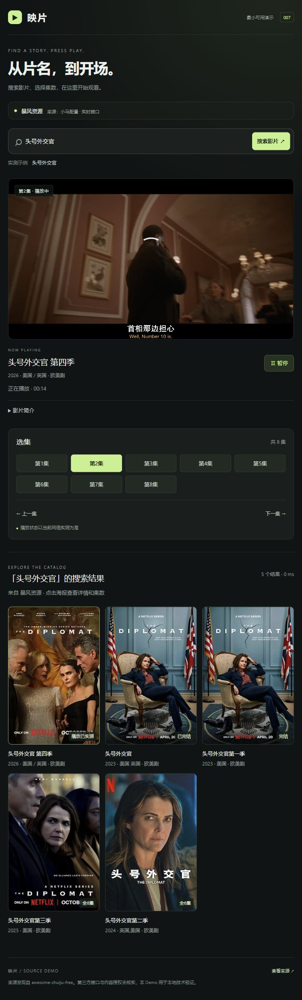

# 007 · 追剧资源接口验证与网页播放 Demo

已实现可运行的本地 Demo：实时搜片、详情、选集和 HLS 播放。后端与网页独立实现，原仓库提供来源线索。



## 立即运行

在研究仓库根目录执行：

```powershell
python -m pip install -r projects/007-zhuiju-source-demo/requirements.txt
python projects/007-zhuiju-source-demo/server.py --port 8767
```

打开 http://127.0.0.1:8767/ 。搜索「头号外交官」，选择标有“播放已实测”的条目（ID 168380），选集后点击播放。片名、年份按第三方数据展示，未独立核实元数据。

## 来源与接口

| 项目 | 实际值 |
| --- | --- |
| 原仓库 | https://github.com/laoma528/awesome-zhuiju-free |
| 查验时 main | d1049a3af73c068c390decc92eebe9bff84d52a0 |
| 发现路径 | resources/resources.json → 小马 → 暴風（type=1） |
| 配置地址 | https://szyyds.cn/tv/x.json |
| API | https://bfzyapi.com/api.php/provide/vod/ |
| 验证样例 | 168380；返回 8 集，首两集已作媒体和浏览器抽样 |
| 视频格式 | HLS，1920×1080 H.264 + AAC |
| 公开部署 | 未部署；不登记公网 demo_url |

**上游没有独立的播放解析端点。** 搜索使用 ac=detail&wd=关键词，详情使用 ac=detail&ids=影片ID；播放地址由详情的 vod_play_from / vod_play_url 提供。本项目将其封装成下面的统一接口。

- GET /api/search?q=片名&page=1：统一搜索卡片。
- GET /api/detail?id=168380：简介、直放线路、集数。
- GET /api/play?id=168380&line=0&episode=0：零基集号，返回直连 HLS 地址与可选本地转发地址。
- GET /api/status：来源、追溯路径与实测样例。

媒体优先由浏览器直连 CDN。搜索数据缓存 45 秒，搜索中取得的完整详情复用 5 分钟，减少冗余请求；不以静态样例替换失败响应。服务只监听 127.0.0.1，限定 API/媒体域名、标准端口、跳转和 DNS，保留 TLS 校验。可选转发接受服务器登记的令牌，没有任意 URL 代理。其他影片可能需先验证并登记其媒体域名。

## 验证

```powershell
python -m unittest discover -s projects/007-zhuiju-source-demo/tests
python projects/007-zhuiju-source-demo/scripts/verify_live.py
python scripts/projects.py check
```

6 项适配/边界测试、9 项实时接口与媒体抽样检查通过。浏览器实际完成搜索、8 集选集、首两集播放、暂停、切集、进度跳转和空结果查询，观察到 1080p 解码帧及播放时间推进。

上游历史条目存在 404，部分分片请求会超时或缓冲；拖动后观察到过超时，已加入有限重试和手动重试入口。未完整观看全片，不能保证全部集数或整个片库始终可用。失败不会用假数据或其他视频冒充。

证据：[实时接口报告](assets/live-verification.json)、[浏览器报告](assets/browser-verification.json)、[编解码报告](assets/ffprobe.json)。筛选过程见 [notes.md](notes.md)。

## 文件与部署

server.py 为独立后端；web/demo.html 为播放器；web/index.html 为可静态发布的研究启动说明。静态构建只提供说明页，不把实时 API 伪装成 GitHub Pages 功能。当前未推送或公开部署。

参见 [运行说明](web/README.md) 和 [第三方来源与许可](THIRD_PARTY.md)。
