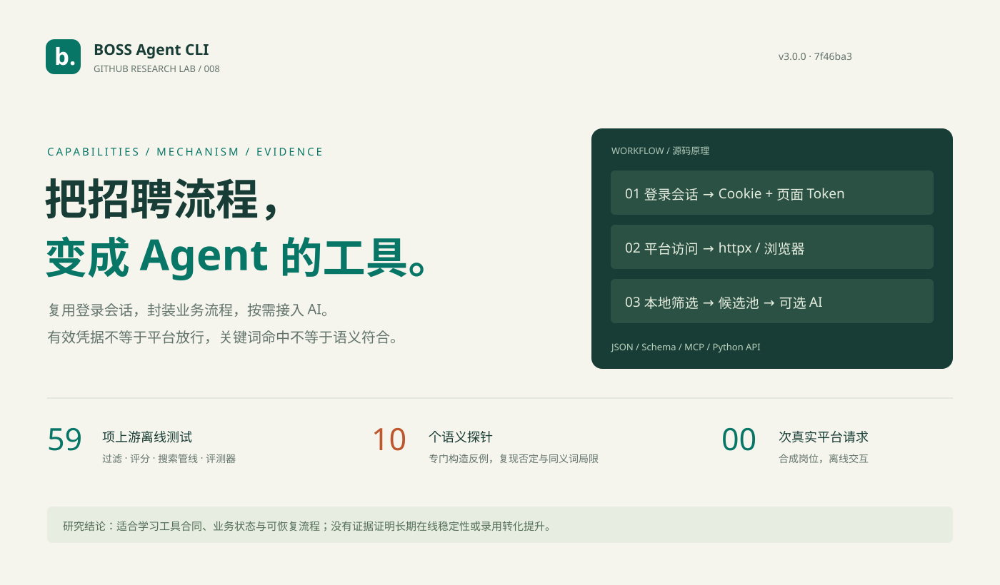
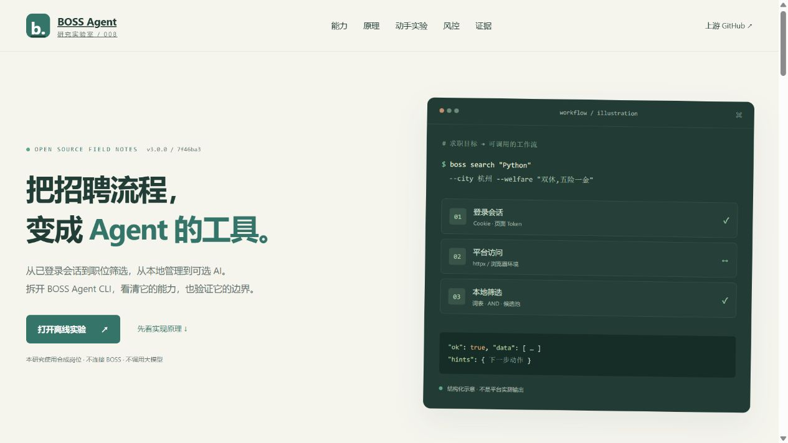

# 008 · BOSS Agent CLI 招聘工作流与风控边界研究

**它把 BOSS 直聘的网页接口、登录会话与招聘业务流程封装为 CLI / MCP 工具。** 搜索与规则筛选不依赖大模型；AI 按需分析简历、JD 和沟通内容。有效 Cookie 只是访问条件之一，部分操作还依赖页面 Token 与浏览器环境，仍受平台权限和风控约束。



| 项目资料 | 内容 |
| --- | --- |
| 上游 | [can4hou6joeng4/boss-agent-cli](https://github.com/can4hou6joeng4/boss-agent-cli) |
| 固定研究版本 | `3.0.0` / [`7f46ba37c654d5f7675bb1328158030d7604847c`](https://github.com/can4hou6joeng4/boss-agent-cli/tree/7f46ba37c654d5f7675bb1328158030d7604847c) |
| 日期 | 首次查验 2026-10-15；子项目整理与验证 2026-10-16 |
| 本轮状态 | 能力说明、源码分析、离线交互演示与本地验证 |
| 实测范围 | 59 项上游离线测试；10 个福利语义探针；4 个原始风险锁判断 |
| 未验证 | 真实登录、在线搜索、沟通/简历送达、浏览器访问平台、大模型质量 |
| 许可证 | 上游 MIT；原始函数摘录保留版权与[完整许可](licenses/boss-agent-cli-MIT.txt) |
| 公网演示 | 未部署；索引 `demo_url` 留空 |

## 先看演示

在仓库根目录运行：

```powershell
python scripts/projects.py check
python scripts/build_web.py
python -m http.server 8768 --bind 127.0.0.1 --directory _site
```

打开 <http://127.0.0.1:8768/projects/008-boss-agent-cli/>。原生 HTML / CSS / JavaScript，无应用依赖，无需 BOSS 账号、Cookie 或模型密钥。

1. 切换「求职者 / 招聘者 / Agent」，查看功能与命令。
2. 点击五个原理步骤，观察会话、请求、筛选、AI 和输出的分工。
3. 用 8 个**合成岗位**改变城市和福利，检查命中依据与人工语义标注。
4. 用语义探针比较「周末双休」「不提供双休」「周末休两天」，观察误判与漏判。
5. 回放环境风险 `37`，再回放一次，观察本地锁拦下第二次模拟请求。「模拟页面恢复」仅改变演示状态，不代表服务端解除限制。

网页不会请求 BOSS、发送消息或调用模型。流程与风控回放为本研究示意；福利规则的 Python 证据由上游原始函数生成，网页 JS 移植逐项核对这些结果。



截图来源：本研究的本地静态页面，1280px 桌面；另有 [手机实验截图](assets/demo-mobile-lab.jpg) 和 [320px 窄屏截图](assets/demo-narrow.jpg)。

## 能力是什么

| 能力 | 作用 | 主要条件 |
| --- | --- | --- |
| 职位发现 | 搜索、推荐、详情、城市/薪资/经验/学历等筛选 | 有效会话及平台可访问 |
| 福利与活跃度 | 词表、AND 条件、HR 在线/近期活跃筛选 | 标签不足时可能增加详情请求 |
| 本地岗位管理 | 候选池、备注、标签、对比、预设和统计 | 本地 SQLite 状态 |
| AI 求职辅助 | 简历与 JD 匹配、润色、面试准备、回复建议 | 另行配置模型服务或本地模型 |
| 求职动作 | 打招呼、立即沟通、交换联系方式等 | 平台权限、会话和端点支持 |
| 招聘者工作流 | 搜索候选人、读简历、沟通、接收附件、管理职位 | 招聘者账号与访问权限 |
| Agent 接入 | CLI、JSON、schema、MCP、Python API | 宿主按能力合同调用 |
| 长任务 | 有界采集、查询、断点恢复、停止与导出 | 额外浏览器依赖、预算与专用 profile |

当前实际注册平台只有 `zhipin`。完整证据见[能力矩阵](capabilities.md)。**`apply` 最小实现复用立即沟通端点，成功不能证明附件简历已送达。** 本地规则评分与大模型分析是两类结果，都不代表录用概率。

## 原理是什么

```text
人 / 外部 Agent → CLI / MCP / Python API → 平台/角色适配器
  → 已登录会话 + httpx 或 CDP / Patchright 浏览器请求
  → BOSS 检查会话、权限与访问环境
  → 本地词表筛选 / 缓存 / 候选池 / 可选模型分析
  → JSON、恢复提示与 workflow checkpoint
```

浏览器通道在页面中执行 `fetch`，一般不需逐次识图点击。`Cookie + __zp_stoken__ + 浏览器环境` 能解释访问链路，不能证明平台接受自动化行为。福利筛选是词表和子串匹配，不理解否定或承诺是否兑现。详见[架构与风控分析](architecture.md)。

## 效果与证据

| 验证 | 结果 | 解释 |
| --- | --- | --- |
| 上游测试子集 | 59 项通过 | 选定的离线过滤、评分、搜索管线和评测器通过 |
| 原始函数语义探针 | 10 例中 4 例与人工标注不同 | 复现否定误判和同义表达漏判；不是准确率基准 |
| 原始风险锁 | 同凭据、变更凭据、未知、损坏 4 例通过 | 本地判断，不能证明服务端解封 |
| 本地浏览器 | 见[验证记录](verification.json) | 研究页面和离线实验的交互验证 |

```powershell
python projects/008-boss-agent-cli/scripts/verify.py
node projects/008-boss-agent-cli/scripts/verify_browser_model.mjs
```

前一条只需 Python ≥ 3.10 标准库，后一条只需 Node.js，无第三方包。[实验输出](references/replay.json) · [测试原始输出](references/core-tests.txt) · [测试范围](references/core-tests.json) · [来源及哈希](references/source-manifest.json)。

重新摘录/运行上游子集，先在仓库外检出固定 commit：

```powershell
python projects/008-boss-agent-cli/scripts/extract_upstream.py <上游目录>
python projects/008-boss-agent-cli/scripts/record_core_tests.py <上游目录>
```

第二条需要当前 Python 已有上游离线测试依赖，不自动安装依赖，也不运行真实平台烟测。完整 CLI 测试因本机缺 Patchright 未运行；未将缺依赖视为上游业务缺陷，未声称全部测试通过。

## 研究判断

- 值得借鉴：工具合同、双角色适配、本地状态、可恢复工作流与结构化恢复动作。
- 稳定性：会话、页面/接口变动和风控决定可用性；限频和停止机制不能承诺永不被拦。
- 筛选质量：适合初筛、组织和对比，福利仍需人工核对。可扩展否定识别、证据片段和“未知”状态，本研究未修改上游算法。
- 效果证据：公开 fixture 与历史少量搜索不足以证明长期在线稳定性或面试/录用率提升。

[研究笔记](notes.md) · [Web 运行说明](web/README.md) · [来源与许可](THIRD_PARTY.md)。
