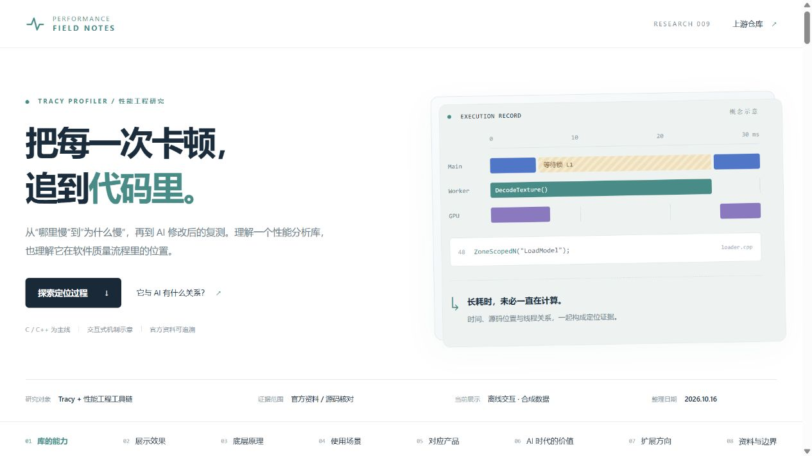

# 009 · Tracy 运行时性能定位与 AI 优化研究

Tracy 通过调用栈采样、区间埋点及线程/锁、GPU、内存事件，定位真实运行中的性能瓶颈。它适合可接入采集的 AI 生成、GitHub 下载或自写项目，用于游戏、桌面、数据处理与服务优化，为开发者和编码 Agent 提供可复测证据。完整保障还需要固定负载、正确性测试、性能预算和外部修复流程。

| 理解维度 | 具体说明 |
| --- | --- |
| 库的能力 | 分析 CPU 热点、单次区间与帧、线程/锁等待、已接入的 GPU 区间和内存分配，保存并比较记录 |
| 底层原理 | 系统采样与符号解析定位执行路径；埋点时间戳记录起止；结合调度、锁、设备与分配事件还原关系 |
| 使用场景 | 游戏/渲染/仿真卡帧、桌面/CAD 慢操作、批处理退化、多线程同步、原生服务与可控 AI/GPU 计算 |
| 可用目标 | AI/GitHub/自写项目均可；官方 C/C++、Python、Lua、Fortran 及第三方语言绑定，定位深度依运行时与平台 |
| 价值与意义 | 降低复现、排查和复测成本，为开发者与编码 Agent 提供运行证据；Assist/MCP 是分析入口，完整自动修复仍需测试与验收流程 |

首页、项目说明和网页使用本次生成的同一张 1920×6830 引导图原文件；PNG/SVG 均可完整查看与下载。下文区分上游已有能力、合成机制演示和扩展设想。

| 项目资料 | 内容 |
| --- | --- |
| 上游仓库 | [wolfpld/tracy](https://github.com/wolfpld/tracy) |
| 固定研究快照 | [fd23005a67e25f53dd420df6350a2f5907afedc3](https://github.com/wolfpld/tracy/tree/fd23005a67e25f53dd420df6350a2f5907afedc3) |
| 查阅时发布标签 | v0.14.1；主分支能力与发布版分别核对 |
| 整理日期 | 初版 2026-10-16；补充理解与总图 2026-10-19（Asia/Shanghai） |
| 研究方式 | 官方资料、关键源码与候选项目工作流核对 |
| 实现内容 | 中文研究网页、1920×6830 全景图、原图阅读/下载、两组离线交互、22 项产品筛选、研究文档 |
| 本地验证 | 初版 21 项；补充版本 30 项浏览器检查，含下载与 375/320px 布局；见 references/supplement-verification.json |
| 未运行 | Tracy 原生采集、C/C++ 性能实测、外部模型与自动修复项目 |
| 上游许可证 | BSD 3-Clause，保留[原始许可](references/tracy-BSD-3-Clause.txt) |
| 公网演示 | 未部署；projects.json 的 demo_url 留空 |

## 网页入口

在仓库根目录执行：

~~~powershell
python scripts/projects.py check
python scripts/build_web.py
python -m http.server 8769 --bind 127.0.0.1 --directory _site
~~~

打开 <http://127.0.0.1:8769/projects/009-tracy-performance/>。无应用依赖，不调用 GitHub、模型、Tracy、采样器或第三方统计服务。按仓库 Pages 子路径构建后访问，文档与资源路径保持一致。

## 网页内容

1. 库的能力：CPU、帧与线程、GPU、内存、记录对比及接入条件。
2. 展示效果：正常记录、卡顿记录和方案推演；选择帧、记录方式及锁事件，检查能得到的证据。
3. 底层原理：调用栈采样、作用域计时、等待与调度、分配释放事件。
4. 使用场景：游戏渲染、C/C++ 桌面与 CAD、数据工具、后端服务。
5. 对应产品：按测量验收、采集定位、AI 修改复测三层筛选 22 项，包含同类分析器与互补工具，比较输出、接入、差异与限制。
6. AI 时代价值：区分 AI 生成的普通软件、包含 AI 功能的产品、用 AI 做性能工程。
7. 扩展方向：统一采集适配、证据结构化、性能门禁与候选修复。
8. 证据范围：固定源码快照、官方来源、交互示意和未验证范围。

AI 章节还说明 Tracy 已有的 Assist 与 MCP 接口，依据 v0.14.1 官方手册核对，区别于后续整合设想。

## 一张图归纳全部理解

[完整 PNG](web/assets/understanding-map.png) · [矢量 SVG](web/assets/understanding-map.svg) · [22 项结构化产品资料](references/products.json)

一图覆盖源库能力、四条采集原理、AI/GitHub/自写代码的适用条件、官方与第三方语言接入、六类场景、22 项同类与互补产品的差异、AI 价值、验收流程和产品思考。网页支持弹窗滚动、原始尺寸、下载与键盘关闭。

产品表新增 Google Benchmark、Valgrind Callgrind/Massif、heaptrack、Perfetto、Nsight Systems、Nsight Compute、OpenTelemetry。不是所有条目都直接替代 Tracy：它们分别解决基准、CPU/系统/内存/GPU 分析和跨服务证据。

AI 生成、GitHub 下载、自写均可；不只 C/C++，官方还支持 Python、Lua、Fortran，Rust、Zig、C# 等有第三方绑定。不同运行时与平台的采样和源码定位能力分别核对。

展开完整理解长图

验证记录见 [verification.json](references/verification.json)，另保留[手机预览](assets/screenshots/mobile.jpg)与[AI 价值章节](assets/screenshots/ai-value.jpg)。这些记录只验证研究网页，不代表运行了上游性能测试。

### 交互边界

- 时间轴全部时长、文件名、行号、线程与锁关系都是合成记录，不是 Tracy 截图或真实运行结果。
- 验收示意预设三种候选，调整阈值观察判定；未执行测试、调用 AI 或修改真实代码。
- 方案推演假定预加载资源并缩小锁范围，不代表已实现优化或测得增益。

## 阅读路径

- [能力与接入条件](capabilities.md)
- [架构、采样与埋点原理](architecture.md)
- [产品对比与选择依据](comparison.md)
- [扩展设想与 AI 价值](extensions.md)
- [研究笔记与本地验证](notes.md)
- [来源与许可](THIRD_PARTY.md)
- [上游快照元数据](references/upstream.json)

## 核心判断

调用栈采样是免业务埋点定位 CPU 热点的核心手段之一。Tracy 还提供区间与事件时间轴，价值在于解释具体帧和线程活动。

普通软件同样需要性能反馈，不要求包含 AI。profiler-md、AGR 更接近普通代码的 Agent 工作流；ParaCodex 与 Atrex 的完整流程偏并行计算或 GPU 算子，不能直接当作任意 C++ 桌面软件的通用保障平台。

本研究没有找到并验证一个面向任意 Windows 原生 C/C++ 工程、零配置完成测试定位修复的成熟通用平台。该结论限定于本轮检索与核对范围。

## 复现资料查验

~~~powershell
python projects/009-tracy-performance/src/collect_sources.py
~~~

只读取 GitHub 官方元数据与 Tracy 原始 LICENSE。重新执行会更新快照，不能把新快照误认为本轮固定版本的运行验证。没有引入上游可执行代码或根目录应用依赖；不为整个仓库自动选定许可证。

## 重建总图与产品资料

~~~powershell
python projects/009-tracy-performance/src/build_overview.py
~~~

作者环境使用 Pillow 与 Windows 微软雅黑字体。图形由代码排版，SVG/PNG 共用坐标与文本；产品事实集中于 references/products.json，同步生成网页数据、长图、封面与 comparison.md。网页运行不依赖 Pillow 或 Python，也不需要运行上游分析器。
