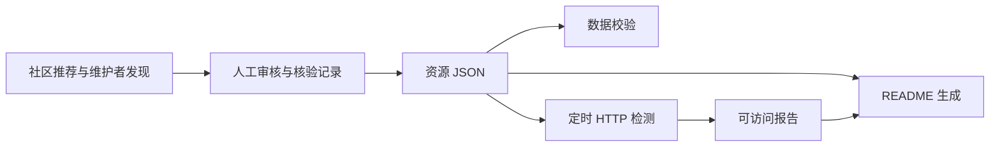
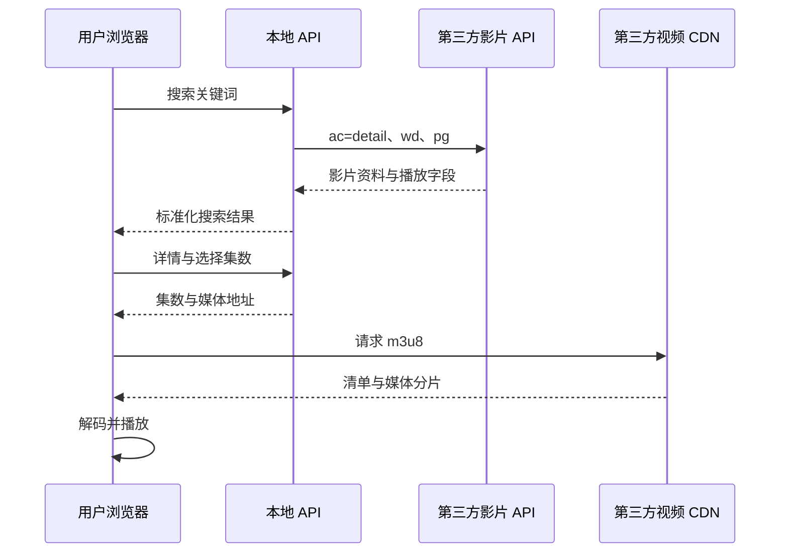

# 原理与实现架构

[返回总览](README.md) · [获取片源](source-acquisition.md) · [分发与成本](distribution-and-cost.md)

## 1. 五个相互独立的层次

| 层次 | 存什么 / 做什么 | 示例 |
| --- | --- | --- |
| 资源目录 | 网站、配置、播放器等入口 | 原仓库 JSON |
| 片目与授权 | 影片、版本、集数、字幕、可用地区和期限 | 自有数据库、供应商交付的元数据 |
| 接入与业务 | 搜索、详情、选集、鉴权、播放会话 | 007 后端或未来生产 API |
| 媒体与分发 | MP4、HLS、分片、存储、转码、CDN | 上游 CDN 或自己的视频服务 |
| 用户体验与运营 | 播放器、收藏、推荐、会员、质量统计 | 网站与运营后台 |

“获取源”可能指前三层中任何一层。谈合作时要明确拿到的是链接、元数据 API、影片文件、播放器嵌入权，还是完整的商业分发许可。

## 2. 原库的目录维护原理



这条链路维护“入口情报”。真正的视频通常位于它推荐的第三方服务中。固定源码和检测范围见 [capabilities.md](capabilities.md)。

## 3. 当前 Demo 的搜片到播放



正常播放时，视频大流量由 CDN 直接流向浏览器。后端处理 JSON，不需要把每个视频字节再搬一次。

## 4. 007 对上游接口做了什么

上游样例使用以下 HTTP 参数。这是本次来源的实际协议形态，不保证其他配置也相同：

| 操作 | 上游参数 | 007 的统一入口 |
| --- | --- | --- |
| 搜索 | `ac=detail&wd=关键词&pg=页号` | `GET /api/search?q=...&page=1` |
| 详情 | `ac=detail&ids=影片ID` | `GET /api/detail?id=...` |
| 取播放地址 | 读取详情中的播放字段 | `GET /api/play?id=...&line=0&episode=0` |
| 来源状态 | 本地已登记来源信息 | `GET /api/status` |

**上游没有被我们验证为存在独立的播放解析接口。** `/api/play` 是我们自己的封装，返回当前集的媒体地址；不能把它描述为已经验证了另一项上游独立服务。

典型播放字段由 `vod_play_from` 和 `vod_play_url` 配合表达。007 按以下层级解析：

1. `$$$` 区分线路。
2. 每条线路的 `#` 区分集数。
3. 每集按第一个 `$` 拆成集名和 URL，保留 URL 自身的查询参数。
4. 只把已识别的 HLS / MP4 作为直放目标；网页地址不能自动当成媒体文件。

不是所有来源都采用这种编码，新增来源应独立实现适配和样例检查。

## 5. HLS 播放原理

HLS 清单通常以 `.m3u8` 表达播放顺序，可能先列不同清晰度，再指向媒体清单。媒体清单列出 TS 或 fMP4 分片及必要的初始化、密钥等依赖。播放器逐步获取、缓冲、解码，并在需要时切换码率。

Safari 等环境可能原生支持 HLS；其他支持 Media Source Extensions 的浏览器可使用 hls.js。浏览器支持 HLS 播放不代表支持所有编码，应以实际编码、音轨和设备验证。[hls.js 官方项目](https://github.com/video-dev/hls.js)

清单返回 200 只完成一层验证。后续分片、音频、跨域权限或有效期任何一层失败，仍会黑屏或卡顿。只有视频尺寸、解码帧和播放时间实际推进，才接近证明样例能播放。

## 6. 适配器和数据模型

建议所有来源先转换为自有模型，前端不要直接依赖供应商字段：

```text
SourceAdapter
  search(query, page) -> CatalogPage
  detail(source_item_id) -> Title + Edition + Episodes
  resolve(episode_id, context) -> PlaybackSession
  health() -> LayeredHealthReport
```

同一影片可能有不同年份、剪辑版、配音和字幕，不应只按中文标题合并。至少区分：

| 实体 | 职责 |
| --- | --- |
| Title | 作品级标题、人物、主题等 |
| Edition | 实际语言、剪辑和画面版本 |
| Season / Episode | 季集结构、顺序与时长 |
| Asset / Rendition | 原片、清晰度、音轨、字幕和编码 |
| License / Availability | 地区、商业模式、期限、合同 |
| SourceMapping | 供应商 ID 与本地 ID 的对应关系 |
| PlaybackSession | 本次选集、授权校验、短时播放地址与过期时间 |

商业播放前检查 License / Availability，再生成会话；不把合同信息只写在运营人员的聊天记录中。

## 7. 搜索与缓存

小片库可用本地数据库或片目 JSON 完成标题、简介和主题检索。供应商文件交付后，定时导入自己的索引即可，用户搜索不必每次请求供应商后台。

接第三方 API 时建议：规范化关键词、限制长度与页数、设置并发与超时、缓存短时结果、合并重复请求、明确错误来源。007 已实现搜索缓存 45 秒、从搜索结果复用详情 5 分钟，减少重复请求导致的上游失败。

播放 URL 可能有签名有效期，不应像静态片目信息一样长时间缓存。缓存必须遵守供应商的更新、删除和存储规则，尤其是平台嵌入 API。

## 8. CORS、HTTPS 与来源限制

- 只返回媒体 URL 并不保证浏览器能读取。采用 hls.js 时，清单、变体清单、分片、初始化文件及所需密钥等依赖要满足浏览器访问条件。
- `Access-Control-Allow-Origin: *` 表达跨域读取规则，不表达商用许可、并发额度或服务保证。
- HTTPS 页面加载 HTTP 媒体可能遇到混合内容限制；优先要求端到端 HTTPS。
- 签名、Referer、域名限制、地域和有效期是来源方可能设置的接入条件。发生限制时应按条款申请接入，不把代理视为自动获得使用权。
- 登录和 DRM 内容需有相应供应商授权及正式播放流程；本项目未实现此类接入。

参考：[MDN CORS](https://developer.mozilla.org/en-US/docs/Web/HTTP/Guides/CORS)。

## 9. 媒体代理的成本与工程边界

007 保留了受限媒体转发，用服务器登记令牌定位已允许的 URL，正常 UI 不使用它。生产若转发 HLS，还需正确处理相对 URL、变体、初始化文件、字幕、字节范围、密钥依赖、重定向与取消请求；只替换第一层 m3u8 往往不够。

代理让流量经过自己的网络，增加带宽和连接成本。它还会使上游看到集中请求，可能触发单 IP 限制。只有在授权、接入条件、需求和预算都明确时才考虑。

任何代理都应限制目标协议、端口和主机；在 DNS 解析及每次重定向后检查地址，阻止内网、localhost、云元数据等目标。不能把任意 `?url=` 接口暴露成公共代理。007 的本机 DNS 代理映射例外只用于该实验环境，不应照搬成公网网络策略。

## 10. 生产化还需补什么

007 的 `ThreadingHTTPServer` 固定监听 `127.0.0.1` 并限制本机 Host / Origin，定位为本地 Demo。迁移时要同时完成生产应用服务、反向代理、可信域名配置和运维，而不仅是把监听地址换成 `0.0.0.0`。

| 部分 | 最小生产能力 |
| --- | --- |
| API | 输入校验、限流、超时、错误码、健康检查 |
| 内容 | 授权状态、可用地区和期限、下架开关 |
| 播放 | 会话、必要的签名、合理缓冲、有限重试 |
| 数据 | 持久数据库、迁移、备份、导入去重 |
| 质量 | 播放成功、首帧、卡顿、错误及来源维度 |
| 成本 | 供应商用量、预算告警、流量额度和异常访问处理 |
| 密钥 | 仅服务端保存；不把管理 API Key 放进前端仓库 |

这些是方案要求，未宣称已在正式站实现。部署选择和费用见 [distribution-and-cost.md](distribution-and-cost.md)。
