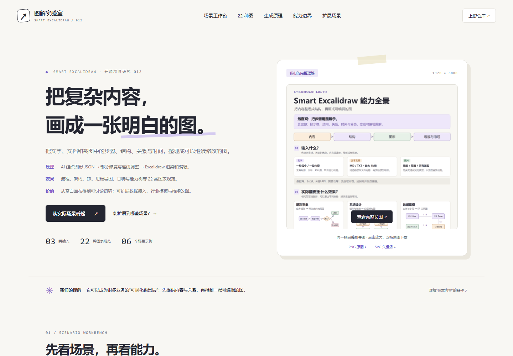

# 012 · Smart Excalidraw 场景与图表能力研究

AI 将文字、文档与截图中的步骤、结构、关系和时间组织成图形 JSON，经部分修复与箭头端点调整，由 Excalidraw 渲染为可编辑图表。含 22 类规范及流程、架构、ER、思维导图、甘特与能力树示例；可扩展数据接入、行业模板、持续改图和团队协作。

| 项目资料 | 内容 |
| --- | --- |
| 上游仓库 | [liujuntao123/smart-excalidraw-next](https://github.com/liujuntao123/smart-excalidraw-next) |
| 固定研究版本 | `fd139925b01ab34203510d6afa560aa56fcc3201` |
| 研究日期 | 2026-10-20 |
| 研究范围 | 源码分析、六个构造场景、22 类图表图鉴、真实 Excalidraw 编辑与导出 |
| AI 验证范围 | 未调用模型；示例不作为模型生成质量证据 |
| 网页入口 | [web/index.html](web/index.html)，需通过 HTTP 预览 |
| 在线地址 | [中文研究网页](https://yydshly.github.io/1015_codex_project/projects/012-smart-excalidraw-next/) |
| 来源与依赖 | [THIRD_PARTY.md](THIRD_PARTY.md) |

## 项目引导图

一张图汇总本质、三类输入、六种场景效果、22 类图表、生成原理、业务价值、扩展方向与能力边界。


[下载 PNG 原图](assets/smart-excalidraw-understanding-20261020.png) · [下载可缩放 SVG](assets/smart-excalidraw-understanding-20261020.svg) · [制图说明](references/overview-brief-20261020.txt)

尺寸为 1920 × 6880。该图为本研究新绘制的矢量信息图，PNG 由浏览器渲染；图中示例表达目标效果，扩展项另作标注。与上游模型质量实测分开。

## 交互网页截图



本研究使用预设场景，在真实 Excalidraw 0.18.0 画布中渲染、编辑和导出；没有调用模型。

## 我们对这个库的理解

它可以作为业务内容的“可视化输出层”：提供可读的内容和关系，让模型组织为图形数据，再交给 Excalidraw 展示、编辑。其主要价值是把空白画布变成可讨论、可修改的初稿。

业务覆盖面来自模型对内容的理解。上游输入入口是文字、MD / TXT 和图片；数据库、Excel、外部 API、完整仓库需要先提取内容或另接连接器。提供能力说明可以画工作流，实际工具执行需要业务系统承担。

## 实际场景

1. 退款审批：自然语言规则 → 带判断分支的流程图。
2. 系统架构：组件与依赖说明 → 分层架构图。
3. 能力整理：项目能力清单 → 输入 / 生成 / 编辑树形图。
4. 数据关系：实体、字段与基数 → ER 图初稿。
5. 知识图解：文章要点 → 思维导图。
6. 项目计划：已经确定的任务与周期 → 甘特图。

上述图均为本研究构造的示例。文字、文件与图片切换说明不同输入路径；切换不会执行文件解析或图片识别。大画布允许真实拖动节点、双击编辑文字、重置、下载 SVG 和 `.excalidraw` 文件，下载保留当前修改。场景切换会载入新的预设图，离开前请下载需要保留的编辑。

## 可扩展场景

- 数据接入：数据库表结构、项目文档、工单规则整理为 ER、架构与流程图。
- 行业模板：审批、技术方案、培训和项目研究复用术语与视觉规范。
- 持续改图：带上当前画布与新增要求，审阅后应用局部修改。
- 团队协作：方案版本、批注、评审与权限管理。
- 业务闭环：由业务系统执行与计算，再整理成状态、时间计划或报告配图。

以上需要额外开发，条件与边界见 [extensions.md](extensions.md)。上游现有输入、单轮生成与箭头优化范围保持分别说明。

## 运行、检查与发布

在仓库根目录执行：

```powershell
python scripts/projects.py check
python scripts/build_web.py
python -m http.server 8884 --directory _site --bind 127.0.0.1
```

本地入口：`http://127.0.0.1:8884/projects/012-smart-excalidraw-next/`。运行文件已保存在 `web/vendor/`，正常预览不需要安装 Node 依赖，也不依赖 CDN。首次重建画布需在本项目目录执行 `npm ci`、`npm run build`；依赖只属于本子项目。见 [Web 说明](web/README.md)。

详细能力与边界见 [capabilities.md](capabilities.md)，研究与验证记录见 [notes.md](notes.md)，主要来源版本与哈希见 [references/sources.json](references/sources.json)。

## 来源与许可

上游 README 标注 MIT；该固定版本根目录未发现独立 LICENSE 文件。源码快照用于研究核对，保留原文；本页没有将上游应用代码作为运行时直接复制。运行时集成 npm 发布的 Excalidraw 及 React，第三方声明随静态构建分发。没有选择或覆盖整个研究仓库的许可证。

## 网页发布记录

2026-10-20：内容提交 `cb46c0ff23f6d499f760f5d25bae249f0ac4785a` 已推送 main，[Pages 任务 39301571743](https://github.com/yydshly/1015_codex_project/actions/runs/39301571743) 构建与部署成功。原图在首页、导航与网页引导中保持一致，完整图弹窗及 PNG / SVG 下载可用。

线上静态内容与原图一致性见 `references/deployed-verification.json`，交互检查与截图见 `references/deployed-browser.json` 和 `assets/deployed-*.png`。研究网页使用构造场景与真实 Excalidraw 画布，未调用模型或部署业务后端。
