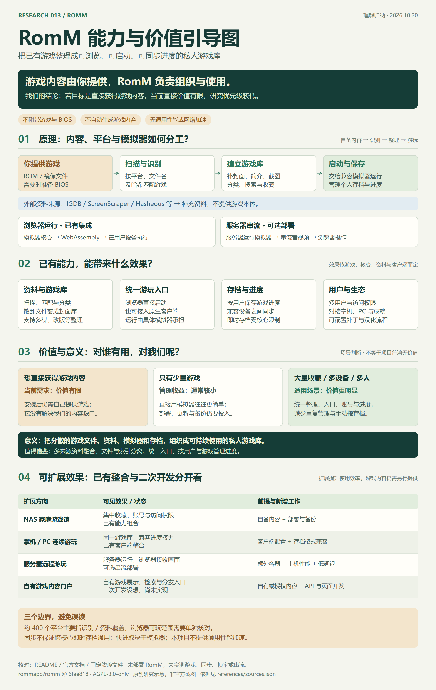

# 013 · RomM 游戏库管理与价值边界研究

RomM 将自己提供的 ROM 游戏文件识别、补齐资料，组织成可浏览、可启动、可同步兼容存档的私人游戏库。它不附带游戏，也不提供通用性能或网络加速。对我们希望直接获得游戏内容的需求，当前直接价值有限；对大量收藏、多设备和多人使用，则有管理、使用与进度同步的整合价值。可进一步组合成家庭游戏馆、掌机接力和服务器串流，也能基于自有或授权内容开发专门的游戏门户。

## 一张图理解 RomM



[查看高清 PNG](assets/romm-understanding-20261020.png) · [查看可缩放 SVG](assets/romm-understanding-20261020.svg) · [制图源代码](tools/draw_guide.py)

图为本研究原创的 1920 × 3036 信息图，用作首页与本页的统一引导。它不是 RomM 的运行截图；“可选部署”和“二次开发设想”已与现有管理能力区分。图中价值判断仅针对明确场景，不表示项目对所有用户价值低。

| 项目资料 | 内容 |
| --- | --- |
| 上游仓库 | [rommapp/romm](https://github.com/rommapp/romm) |
| 固定研究版本 | [`6fae8185f81dd4897940e76045bc9834cfb798d1`](https://github.com/rommapp/romm/tree/6fae8185f81dd4897940e76045bc9834cfb798d1) |
| 研究日期 | 2026-10-20 |
| 研究状态 | 本轮文档研究完成；当前需求下优先级较低，保留记录并归档 |
| 上游许可证 | AGPL-3.0-only，见保留原文的 [LICENSE](references/upstream/LICENSE) |
| 验证范围 | 官方文档、固定 README 和依赖文件核对；未部署 RomM，未实测游戏、同步、帧率或串流 |
| 来源记录 | [sources.json](references/sources.json)，包含版本、文件哈希和官方文档依据 |
| 上游演示 | [官方 Demo](https://demo.romm.app/)；不是本研究部署或运行验证 |

## 我们对它的理解

可以概括为：**自己准备游戏，RomM 提供游戏书架、统一游玩入口和存档管家。**

- **内容层**：ROM、镜像及需要的 BIOS 由使用者准备。只部署平台而不导入文件，不会自动获得游戏库。
- **管理层**：识别文件、补资料、做分类和搜索，管理用户、权限、收藏与存档。
- **运行层**：具体游戏交给集成或对接的模拟器执行；浏览器模拟在用户设备运行，可选串流则在服务器运行。
- **效率层**：减少重复整理、寻找文件和手动搬存档的步骤。游戏快进属于具体模拟器功能；它没有通用性能或网络加速的核心定位。

这里的“没有内容”特指**不附带游戏本体**。配置资料来源后，它能获得封面、简介、截图等游戏资料；这些资料不等于可运行的游戏文件。[官方 FAQ](https://docs.romm.app/latest/about/faqs/) 对软件定位与不附带 ROM / 固件作了说明。

## 能力、原理与效果

| 能力 | 如何实现 | 使用效果与条件 |
| --- | --- | --- |
| 游戏库整理 | 扫描平台目录与文件信息，建立数据库索引 | 把散乱文件变成按平台浏览、检索和收藏的游戏库；支持多碟、改版等组织方式 |
| 资料匹配 | 按来源使用文件名、哈希或游戏标识匹配，将多来源字段按优先级融合 | 补充封面、简介、截图等；覆盖程度依平台、来源和文件版本而定，误配可能需要人工修正 |
| 网页游玩 | EmulatorJS 等组件载入模拟器核心；EmulatorJS 使用 WebAssembly 在用户设备执行 | 支持的游戏可从网页启动；流畅度和兼容性依游戏、核心、浏览器与终端而定 |
| 个人进度 | 按用户和游戏管理存档、即时存档，和浏览器或客户端同步 | 兼容设备可接着玩；游戏内存档需格式兼容，即时存档通常受模拟器核心和版本约束 |
| 用户与客户端 | 配置访问权限，连接 Playnite、Android、掌机等生态客户端及成就服务 | 同一个库可面向不同用户和终端；客户端与外部服务仍需各自配置 |
| 可选服务器串流 | 额外部署服务器模拟器与串流容器，把画面、声音传到浏览器并接收输入 | 可统一远程游玩入口；需要服务器算力、模拟器配置、网络和额外维护，不是默认轻量部署的效果 |

完整链路为：**自备游戏 → 扫描识别 → 补充资料 → 展示与选择 → 模拟器运行 → 存档上传 / 同步 → 兼容设备继续游玩**。

平台本身采用 Vue / TypeScript 前端与 Python FastAPI 后端，使用数据库保存索引和用户数据，磁盘保存游戏、图片与存档，后台队列处理扫描等任务。工程意义在于把文件、资料、运行入口与用户进度组织成完整使用流程。[架构文档](https://docs.romm.app/latest/developers/architecture/)

## 价值与研究结论

| 使用目标 | 我们的判断 | 原因 |
| --- | --- | --- |
| 直接获得现成游戏内容 | 当前直接价值有限，研究优先级较低 | 内容仍需另行准备，安装平台没有消除内容缺口 |
| 偶尔玩几个游戏 | 管理收益通常较小 | 直接使用模拟器往往更简单，平台部署、更新和备份有维护成本 |
| 大量已有收藏 | 有整合价值 | 封面、资料、分类、检索与统一入口减少重复整理 |
| 多设备、掌机或家庭多人 | 价值更明显，需验证兼容性 | 统一库和权限，兼容进度跟随用户；仍需客户端及同步配置 |
| 学习工程设计或开发自有产品 | 保留作参考 | 可借鉴多来源资料融合、文件与索引分离、统一入口、按用户与游戏组织存档 |

**我们的最终结论是“对当前内容获取需求价值有限，作为已有游戏的组织与使用平台有条件价值”。** 本轮完成理解归纳与引导图后归档，不投入游戏运行或性能复现实验。将来明确拥有一批游戏或出现跨设备管理需求时，可基于本记录重新评估。

## 可扩展效果与投入

| 方向 | 状态 | 可以得到的效果 | 需要补齐什么 |
| --- | --- | --- | --- |
| NAS 家庭游戏馆 | 已有能力的配置组合 | 在同一服务器管理游戏、用户与访问权限 | 自备游戏，部署、配置资料来源、备份与维护 |
| 掌机 / PC 连续游玩 | 已有生态整合 | 在不同客户端访问同一库，兼容存档接力 | 安装与配对客户端，验证游戏版本、核心及存档格式 |
| 服务器远程游玩 | 可选串流部署 | 服务器运行 PCSX2、Dolphin 等模拟器，浏览器接收画面并操作 | 额外容器与模拟器配置，服务器性能、BIOS、网络及并发容量 |
| 自有游戏内容门户 | 本研究提出的二次开发设想，尚未实现 | 为自有或授权游戏提供专题展示、检索与分发入口 | 实际内容、API / 页面开发、发布与维护；不会凭空产生游戏 |

上述效果是文档支持的使用方式或明确标注的设想，不是本研究已跑通的演示。扩展可以提升内容的使用效率，不能替代内容来源，也不能保证所有游戏、设备和存档相互兼容。

## 容易误读的边界

1. **约 400 个平台不是全部能在浏览器游玩。** 平台支持主要包含目录识别与资料覆盖，可玩的模拟器核心范围需另外核对。[平台支持说明](https://docs.romm.app/latest/platforms/supported-platforms/)
2. **统一入口不等于自研模拟器。** RomM 负责组织与整合，模拟执行由 EmulatorJS 等组件或服务器上的原生模拟器承担。[浏览器运行](https://docs.romm.app/latest/using/in-browser-play/emulatorjs/)、[服务器串流](https://docs.romm.app/latest/using/emulator-streaming/)
3. **存档同步不等于即时存档跨核心通用。** 游戏内存档与即时存档不同，后者通常绑定核心与版本。[存档兼容说明](https://docs.romm.app/latest/using/saves-and-states/)
4. **快进、帧率和网络加速是不同事情。** 快进是否可用取决于模拟器；本研究没有将通用性能提升或网络加速归为 RomM 的核心能力。

## 来源、许可与复现

- [来源与主张对应表](references/sources.json)：固定四份上游资料的 SHA-256，记录八篇官方文档链接和用途；`latest` 文档可能继续变化，不能视为与源码完全同版。
- [研究笔记](notes.md)：讨论结论、价值判断与验证边界。
- [第三方声明](THIRD_PARTY.md)：上游资料用于研究，保留版权和许可证；未引入 RomM 运行时、游戏或 BIOS。
- [制图与检查记录](references/guide-generation.json)：图像尺寸、哈希、文字边界检查与人工审阅记录。

重新导出图像需要本地安装 Pillow、Playwright 及 Chromium，并使用 Windows 的 Microsoft YaHei 字体；其他系统需调整脚本中的字体路径。这些只属于本子项目制图工具，不是根目录应用依赖：

```powershell
python projects/013-romm/tools/draw_guide.py
python scripts/projects.py sync
python scripts/projects.py check
```

`tools/capture_sources.py` 可重新获取固定源码资料并更新文档访问哈希；运行后需人工检查来源变化。此项目只发布图文研究，没有新建 Web 应用，`demo_url` 保持空值。[Web 目录说明](web/README.md)
