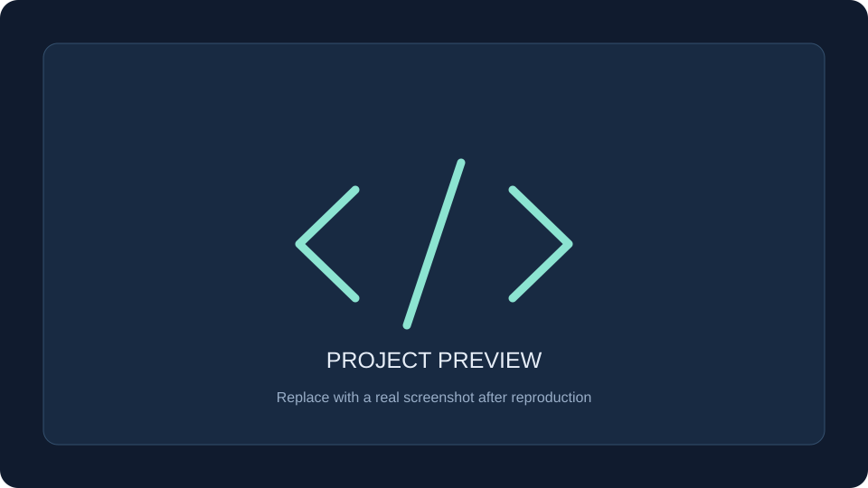

# {{ID}} · {{NAME}}

{{SUMMARY}}

| 项目资料 | 内容 |
| --- | --- |
| 上游仓库 | [{{REPOSITORY}}]({{REPOSITORY}}) |
| 收录编号 | `{{ID}}` |
| 研究状态 | 待研究；最新状态见[首页索引](../../README.md#项目索引) |
| 研究版本 | 待记录 tag / commit SHA |
| 上游许可证 | 待核实；引入代码前记录 |
| 演示地址 | 待部署，验证后填入 `projects.json` 的 `demo_url` |

## 项目预览

当前为统一占位封面，尚无项目截图。补充真实截图后替换图片，说明展示内容，并在下方标明截图来源与研究版本。

## 为什么研究

- 解决的问题：待补充。
- 值得学习的设计：待补充。
- 希望验证的问题：待补充。

## 快速开始

研究过程中记录实际验证过的环境、安装、启动和访问步骤。实验代码放在 `src/`，Web 演示放在 `web/`。

详细过程见[研究笔记](notes.md)，多 Web 发布方式见[部署约定](../../docs/deployment.md)。

## 核心设计与收获

待研究后补充，尽量用代码位置、运行结果或图片支撑结论。

## 来源与许可

- 上游项目：{{REPOSITORY}}
- 研究版本：待记录。
- 图片来源：当前为本仓库生成的占位封面；替换后记录真实来源。
- 引用或改造的上游代码及其许可证：待记录。
